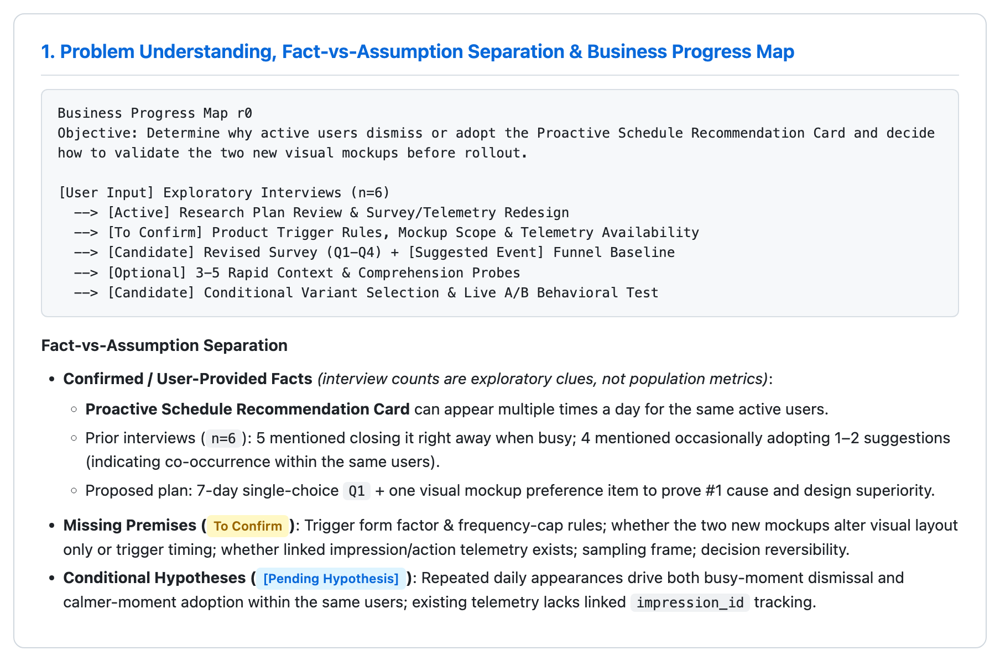
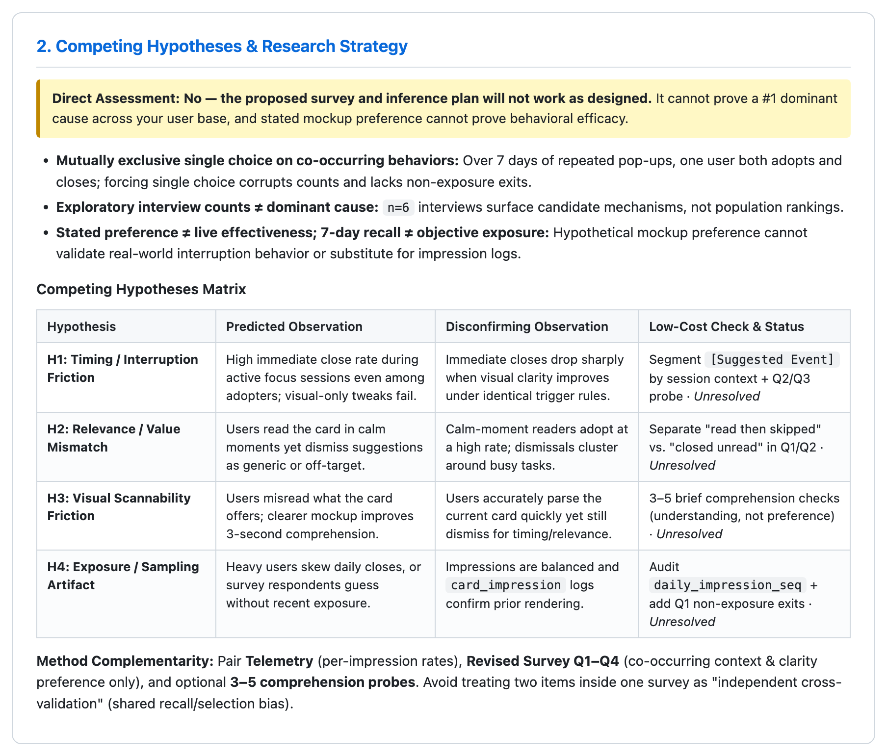
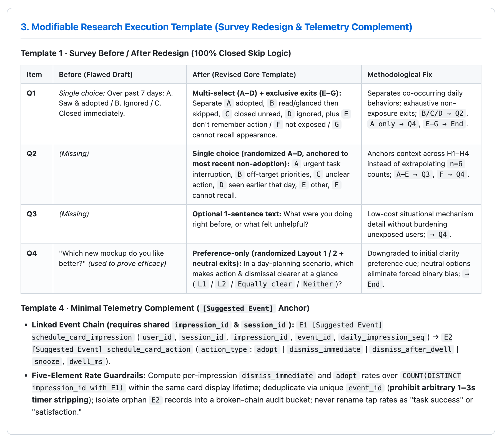
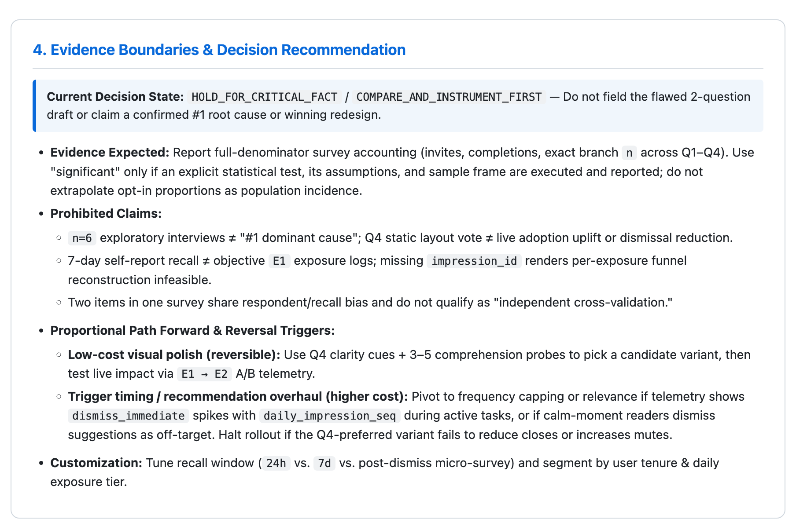

# UXDA — User Experience Decision Advisor (Public Core v0.1.0-beta.4-rc.2)

English | [简体中文](README.zh-CN.md)

[](#license)
[-orange.svg)](#version-mapping--release-identity)
[](#architecture--clean-separation)

---

## 1. What UXDA Is

UXDA (**User Experience Decision Advisor**) is a unified AI agent skill package (`skills/ux-decision-advisor`) for UX research, interaction design review, and human factors reasoning. Through structured methodological framing, evidence boundary checks, and modifiable study instruments, UXDA helps practitioners formulate research questions, examine competing explanations, design low-resource research pilots, and evaluate design trade-offs.

UXDA is a **structured reasoning and decision-support tool**, not an empirical research substitute or automated certification authority.

> ### ⚠️ Critical Professional & Safety Disclaimer
> - UXDA outputs are **conditional proposals for discussion**, never finalized corporate resolutions, legal clearances, or engineering approvals.
> - UXDA **does not replace qualified human experts**, empirical user research, regulatory approvals (e.g., FDA, FAA, EU MDR), technical standards certification (e.g., ISO, GB), or physical/safety testing.
> - **Host Platform Scope**: UXDA consists solely of local Markdown skill instructions, reference protocols, and Python standard-library scripts (`local_evidence.py` supports optional external `.docx`/`.xlsx`/`.pdf` parsers if installed). Network transmission, LLM inference, and session retention depend entirely on your host AI agent platform (see [SECURITY.md](SECURITY.md)).

<a id="architecture--clean-separation"></a>
<a id="architecture"></a>
### Architecture & Clean Separation

UXDA follows a **Standalone-First, Interoperable-by-Design** layout separating the **Public Core** from optional private extensions:

```text
UXDA Public Core
    │
    ├── skills/ux-decision-advisor/SKILL.md (Unified Single-Skill Entrypoint)
    │       ├── Guided     (Methodology learning, construct & bias explanation)
    │       ├── Decision   (Design trade-offs, competing hypotheses & reversal triggers)
    │       ├── Project    (Study protocols, modifiable execution templates & telemetry audits)
    │       └── Specialist (Direct ergonomic geometry, hitbox bounds & friction review)
    │
    ├── skills/ux-decision-advisor/references/ (On-demand methodology, execution templates & standards)
    ├── skills/ux-decision-advisor/scripts/    (Offline Python verification, audit & evidence tools)
    │
    └── Optional External Context Bundle Contract (v0.2 Generic Specification)
            └── User-Maintained Private Extensions (Proprietary rules & data, kept outside repo)
```

<a id="version-mapping--release-identity"></a>
<a id="versioning"></a>
### Version Mapping & Release Identity

| Component / Layer | Public Version | Evolution Track | Role & Scope |
| :--- | :---: | :---: | :--- |
| **UXDA Public Core (Active RC)** | **`v0.1.0-beta.4-rc.2`** | *Peer Review Candidate (branch `release/beta4-rc1`, PR #5)* | Current active release candidate for external peer testing and methodology evaluation |
| UXDA Public Core (Historical RC) | `v0.1.0-beta.4-rc.1` | *Peer Review Candidate 1* | First peer review candidate (archived) |
| UXDA Public Core (Stable Baseline) | `v0.1.0-beta.3` | *Source-Available Public Beta (on GitHub `main`)* | Current official stable baseline on default branch |
| `skills/ux-decision-advisor` (Unified Skill) | `v0.1.0-beta.4-rc.2` | Consolidated Router (v0.5.4) + Specialist (v0.7.0) | Single entrypoint delivering Guided, Decision, Project, and Specialist workflows |
| Context Bundle Contract | `v0.2` | Generic Specification v0.2 | Optional JSON interchange specification (no bundled enterprise backend) |

---

## 2. Core Capabilities

No separate skills, custom slash commands, or hosted APIs are required. UXDA routes natural-language requests across four internal capabilities within `skills/ux-decision-advisor/SKILL.md`:

| Capability | Intended Use | Representative Output |
| :--- | :--- | :--- |
| **`Guided`** | Learning UX research methods, bias control, construct validity, and where to start | Problem framing, methodological rationale, applicability trade-offs, and guided practice |
| **`Decision`** | High-stakes product/UX trade-offs, error-mode critique, and decision framing | Competing hypotheses, reversal triggers, conditional choices (`Keep` / `Do Minimum` / `Pilot` / `Hold`) |
| **`Project`** | Study planning, low-resource research pilots, survey/interview redesign, and telemetry sanity checks | Modifiable execution templates (`research-execution-templates.md`), 5-element metric definitions, and broken-chain guards |
| **`Specialist`** | Direct human-factors, physical display/touch sizing, and interaction friction review (no questionnaire blocker) | Reproducible geometric math (under explicit scaling assumptions), hitbox vs. visual bounds, and ergonomic risk checks |

---

## 3. What's New in `v0.1.0-beta.3`

This release renames the product to **User Experience Decision Advisor (UXDA)** and the installable Skill to **`ux-decision-advisor`**, without changing the four-capability workflow. The repository was renamed from `RagnTec/User-Experience-Decision-Assistant` to `RagnTec/User-Experience-Decision-Advisor`; historical Beta tags remain unchanged. New users can run:

```bash
npx skills add RagnTec/User-Experience-Decision-Advisor --skill ux-decision-advisor
```

Existing `uxda` installations do not automatically migrate; use [INSTALLATION.md](INSTALLATION.md) for a controlled transition.

### Previously: `v0.1.0-beta.2`


`v0.1.0-beta.2` transitions UXDA from pure methodology recommendations to **execution enablement** with hardened epistemic and measurement guardrails:

- **Added Modifiable Research Execution Templates** ([research-execution-templates.md](skills/ux-decision-advisor/references/research-execution-templates.md), Templates 1–5): Structured survey, qualitative interview, usability testing, behavioral telemetry event chains, and **low-resource / constrained research pilot** strategies—with explicit research rationale, customizable parameters, evidence limits, and decision links.
- **Fact vs. Assumption Gate**: Strictly separates `(a) confirmed user-provided facts`, `(b) missing premises (To Confirm)`, and `(c) [Pending Hypothesis]` before locking study objects or metrics—preventing inferred product capabilities from being presented as established facts.
- **Survey & Qualitative Rigor**: Prohibits stuffing co-occurring behaviors (e.g., adopt, ignore, dismiss over 7 days) into mutually exclusive single-choice items; requires closed skip logic; forbids elevating exploratory small-sample interview counts into population "dominant cause" rankings or treating static mockup preference as validated live effectiveness.
- **Behavioral Telemetry Integrity**: Separates entry CTR, result CTR, task success rate, and subjective satisfaction; prohibits renaming proxy click ratios as "task success" or "satisfaction"; prohibits mechanical 1–3s interval deduplication (prioritizes unique `event_id`, `impression_id`/`session_id`, and interaction semantics).
- **Method Complementarity & Proportionate Gating**: Distinguishes method complementarity, shared recall/selection bias, and independent replication; calibrates verification bars to evidence strength, decision risk, cost, and reversibility rather than mechanically blocking low-risk reversible fixes.

---

## 4. Representative Workflow Examples

### 4.1 Historical Baseline: Multi-Panel Protocol (`DEMO-01`, `v0.1.0-beta.2`)

> **Case Provenance & Synthetic Data Note:** The business context, 6 interview participants, and associated behavior counts in `DEMO-01` are **synthetic test inputs**, not real user research results. The Agent outputs below come from an actual UXDA `v0.1.0-beta.2` execution; the Chinese panels in [README.zh-CN.md](README.zh-CN.md) are faithful translations and re-typeset localizations of this same run (existing image files keep their original filename prefixes).

> **Scenario Prompt (`DEMO-01`):**
> *"We built a 'Proactive Schedule Recommendation Card' inside our productivity app (it can pop up or appear multiple times a day for the same active users). Earlier we ran exploratory interviews with 6 users (5 casually mentioned 'often closing it right away when busy,' and 4 mentioned 'occasionally adopting one or two suggestions'). I want to send a minimal survey: Q1 (single choice) 'Over the past 7 days, what did you do with the proactive recommendation card? A. Saw and adopted / B. Ignored without looking / C. Closed immediately,' plus one question showing users two new visual mockups to pick which one they like better—and use the results to prove the #1 dominant cause from our interviews and prove the new mockup works better. Does this work? Please give revision recommendations and a minimal execution framework."*

#### Step-by-Step Excerpts from One Continuous `DEMO-01` Output

##### Panel 1 · Problem Understanding & Business Progress Map

<a href="docs/media/demos/tc01-1-progress.png"></a>

*Caption:* Tracks workflow state (`Business Progress Map r0`) and strictly separates confirmed inputs, `To Confirm` premises, and `[Pending Hypothesis]` assumptions before designing research.

##### Panel 2 · Competing Hypotheses & Research Strategy

<a href="docs/media/demos/tc01-2-hypotheses.png"></a>

*Caption:* Rejects invalid causal/single-choice leaps, structures four falsifiable competing hypotheses (`H1–H4`), and pairs telemetry, survey, and probes while guarding against shared bias.

##### Panel 3 · Modifiable Execution Templates (Survey & Telemetry)

<a href="docs/media/demos/tc01-3-template.png"></a>

*Caption:* Converts the flawed draft into closed skip-logic `Q1–Q4` survey items (separating co-occurring behaviors) and linked `[Suggested Event]` telemetry without blind 1–3s deduplication.

##### Panel 4 · Evidence Boundaries & Decision Recommendation

<a href="docs/media/demos/tc01-4-boundaries.png"></a>

*Caption:* Defines full-denominator and sampling limits, blocks small-sample extrapolation or preference-as-efficacy claims, and specifies proportional next steps and reversal triggers.

---

### 4.2 Current Release Candidate: Business-First Triage Protocol (`DEMO-02`, `v0.1.0-beta.4-rc.2`)

> **Case Provenance & Synthetic Data Note:** The scenario, telemetry parameters, and combat friction context in `DEMO-02` are **synthetic evaluation benchmarks** used during automated regression testing, not proprietary game studio data. The excerpts below reflect actual UXDA Release Candidate execution demonstrating the **business-first output protocol** (direct findings first, bounded hypotheses, realistic resource calibration, and on-demand theoretical expansion).

> **Scenario Prompt (`DEMO-02`):**
> *"Players in our online combat game report frequent 'network lag / frame drops / high ping' during team fights. Our backend server monitoring shows normal round-trip latency without abnormal spikes. The technical team suspects player excuse / self-serving bias ('blaming lag for lost fights') or poor local WiFi. We have only 2 UX researchers and a 5-day budget. How should we investigate this problem, and what qualitative/quantitative conclusions can we provide to leadership?"*

#### Step-by-Step Excerpts from `DEMO-02` Output

1. **Direct Grounding in User Sensory Encounters**:
   > *"Do not dismiss player complaints as 'self-serving bias' or excuse-making. In high-tempo combat, perceived 'lag' represents authentic experiential friction: momentary loss of input control, interrupted visual pacing, and sensory dissonance between button press and character action. Even when server ping metrics appear normal, players are encountering real disruption."*

2. **Bounded Hypotheses Matrix (Multi-Mechanism Discrimination)**:
   > *"Normal server round-trip time (RTT) only proves that the server-to-gateway path is responsive; it does not eliminate client-side or transient communication bottlenecks. UXDA formulates four competing hypotheses:*
   > - *`H1 (Server-to-Client Packet Jitter)`: Micro-burst packet drops or out-of-order delivery during high-density ability synchronization.*
   > - *`H2 (Client Rendering Frame Hitching)`: Sudden GPU/CPU frame-time spikes (>50ms) caused by particle effects, asset instancing, or thermal throttling.*
   > - *`H3 (Dynamic Asset Streaming IO Contention)`: Asynchronous background loading of ability sound/visual assets on mobile storage starving the main render thread.*
   > - *`H4 (HUD Display Smoothing Desync)`: The in-game ping display applying a rolling moving-average that conceals instantaneous millisecond latency spikes.*"

3. **Realistic Resource-Calibrated Triage Plan (2 Researchers, 5 Days)**:
   > - ***Days 1–2 (Dual-Stream Capture Pairing)***: Record 10 reproducible team-fight sessions simultaneously capturing 60fps device screen video alongside local Wireshark/pcap network traces to correlate user-perceived stutter timestamps with packet arrival times.
   > - ***Day 3 (Spike Isolation & Telemetry Check)***: Analyze 99th percentile frame times ($P_{99}$) and packet arrival intervals during ability triggers.
   > - ***Days 4–5 (Joint Triage with Client Engineering)***: Align on candidate guardrail metrics (e.g., $P_{99}$ frame hitch duration < 33ms) and trigger thresholds.

4. **Engineering Boundary Respect**:
   > *"UX research identifies the experiential triggers, user sensory thresholds, and guardrail metrics; UX research does not prescribe low-level engine rendering pipelines, dynamic LOD parameters, or server replication architectures. Technical implementation remains the domain of client and engine engineering."*

5. **On-Demand Progressive Expansion**:
   > *When the user subsequently asks: 'Can you expand on the theoretical models and specific telemetry instrumentation?' UXDA unpacks the mathematical definitions of frame hitch distributions, telemetry payload schemas, and statistical variance estimation without cluttering the initial business summary.*

### Screenshot-to-Capability Mapping

| Screenshot | Focus Region | UXDA Capabilities Demonstrated |
| :--- | :--- | :--- |
| [Panel 1](docs/media/demos/tc01-1-progress.png) | Problem Framing & Progress Map | **Workflow Tracking (`business-progress-map`) & Fact-vs-Assumption Gate**: Prevents unverified trigger/telemetry assumptions from becoming project facts. |
| [Panel 2](docs/media/demos/tc01-2-hypotheses.png) | Competing Hypotheses & Strategy | **Decision & Analytical Quality (`H1–H4`, Method Complementarity)**: Blocks premature "dominant cause" claims and separates complementary signals from shared bias. |
| [Panel 3](docs/media/demos/tc01-3-template.png) | Survey & Telemetry Instruments | **Project Execution Templates (`Template 1` + `Template 4`)**: Generates editable Q1–Q4 closed skip logic and `[Suggested Event]` 5-element metric guardrails. |
| [Panel 4](docs/media/demos/tc01-4-boundaries.png) | Evidence Boundaries & Decision Link | **Evidence Boundaries & Proportionate Decision Gating**: States prohibited inferences, ownership limits, and exact reversal triggers for pilot vs. live rollout. |

---

## 5. Best Fit & Non-Goals

| Best Suited For (Supported Today) | Not Suited For / Non-Goals |
| :--- | :--- |
| Structured problem framing, competing-hypothesis analysis, and UX methodology learning (`Guided` / `Decision`) | Replacing empirical user testing, production telemetry, or qualified human factors experts |
| Designing and auditing **low-resource research pilots**, survey wording, interview probes, and telemetry event chains (`Project`) | Extrapolating convenience surveys or small qualitative samples (`n=3–6`) into population prevalence or rankings |
| Fast, direct ergonomic geometry math and interaction-friction walkthroughs without blocking questionnaires (`Specialist`) | Statutory safety certification, legal sign-off, medical/automotive compliance approval, or physical lab verification |
| Offline local-document evidence retrieval (`local_evidence.py`) and user-confirmed Markdown/H5 briefs | Built-in GUI consoles, automated rule repositories, live network telemetry collection, or guaranteed cross-host auto-discovery |

---

## 6. Quick Start

### 1. Install `skills/ux-decision-advisor` (macOS / Linux)

UXDA is an **agent skill package, not a standalone application**. Your AI host must support reading local `SKILL.md` files.

```bash
git clone https://github.com/RagnTec/User-Experience-Decision-Advisor.git
cd User-Experience-Decision-Advisor
mkdir -p ~/.agents/skills
cp -R skills/ux-decision-advisor ~/.agents/skills/

# Verify entry file
test -f ~/.agents/skills/ux-decision-advisor/SKILL.md
```

**Optional Google Antigravity discovery link (verified environment example):**

```bash
mkdir -p ~/.gemini/config/skills
ln -s ~/.agents/skills/ux-decision-advisor ~/.gemini/config/skills/ux-decision-advisor
```

> **Note:** Check for an existing directory or symlink before running `ln -s`. This path is an example from the tested environment, **not a universal path guaranteed for Claude Code, Cursor, Codex, or Gemini CLI**. **While the repository remains Private, cloning requires GitHub access.**

### 2. Invoke UXDA via Natural Language

- **Guided (Methodology & Problem Framing):**
  `Use the installed uxda skill: Shoppers seem to miss our product filter in a shopping app. How should we separate discovery gaps from low user intent before launching a survey?`
- **Decision (Trade-offs & Reversal Conditions):**
  `Use the installed uxda skill: Compare removing the confirmation dialog before bulk file deletion vs. making deletion reversible with Undo. Highlight cognitive slip risks and reversal gates.`
- **Project (Execution Templates & Low-Resource Pilot):**
  `Use the installed uxda skill: Give me a modifiable 4-item interview guide and a [Suggested Event] telemetry check to diagnose onboarding drop-off under a tight 1-week pilot budget.`
- **Specialist (Direct Ergonomic Review — No Questionnaire Blocker):**
  `Use the installed uxda skill: On a 10.1-inch 1280×800 industrial touchscreen, evaluate 36×36 px buttons for operators wearing thin gloves.`
- **With Local Documents (Offline Manifest Search):**
  See [Local Knowledge & Evidence Layer](skills/ux-decision-advisor/references/local-knowledge-evidence.md) for using `python3 skills/ux-decision-advisor/scripts/local_evidence.py` with an explicit local manifest—kept strictly outside the Public Core repository.

---

## 7. Limitations & Boundaries

- **Known Beta Limitation (Standards & Quantitative Thresholds):** Specific external standard clause citations and uncalibrated quantitative thresholds remain subject to model/reference errors; critical human-factors, safety, and compliance judgments must be verified against authoritative primary standards and real-device testing.
- **Epistemic & Measurement Boundaries:**
  - Qualitative samples and convenience/opt-in surveys cannot establish population-level incidence or "#1 root causes."
  - Stated preference for static mockups does not validate real-world behavioral efficacy.
  - Proxy click-through ratios (such as `result clicks / home impressions`) must never be mislabeled as "task success rate" or "user satisfaction," and missing `session_id`/`impression_id` prevents per-exposure funnel reconstruction.
- **Host Platform Compatibility Scope:** Installation, discovery symlinks, and live skill runs have been verified only in the local `~/.agents/skills/ux-decision-advisor` + Antigravity setup. Cross-host discovery and behavior on **Claude Code, Cursor, Codex, Gemini CLI**, and external skill hubs (**SkillX, Tencent SkillHub**) have **not** been verified in live end-to-end tests; follow [INSTALLATION.md](INSTALLATION.md) for host-specific path binding.

---

## 8. Peer Review Trial Guide & Feedback Program (Beta.4 RC.2)

UXDA is an experimental AI Agent Skill designed for user research, interaction design decision-making, and human-factors tasks. It delivers four core capabilities:
- **Guided**: Research knowledge and methodology explanation.
- **Decision**: UX trade-offs and decision risk support.
- **Project**: Study planning, lightweight instrument execution, and telemetry audit.
- **Specialist**: Direct ergonomic evaluation, hitbox boundary check, and friction review.

### What is Enhanced in v0.1.0-beta.4-rc.2
1. **Agent Skills Specification Compliance**: Frontmatter strictly formatted with string-to-string metadata mapping, resolving compatibility issues with modern Agent Skill runners.
2. **Business-Facing Presentation**: Default responses answer the core business question directly (*Judgment → Evidence & UX Mechanism → Business Impact & Next Step*), without forcing internal status maps or robotic formatting.
3. **Evidence-Based UX Reasoning**: Anchors problem framing in authentic user encounters, task interruption, and feeling of control, rather than premature engineering architecture.
4. **Methodological & Statistical Discipline**: Faithfully aligns with ISO 9241-11:2018 conceptual usability definitions; strictly prohibits claiming $p > 0.05$ proves equivalence; accurately operationalizes CTR (clicks ÷ exposures) and relative vs. percentage point changes.
5. **Progressive Depth on Demand**: In-depth theoretical models, measurement construct operationalization, and statistical calculations unfold upon follow-up request.
6. **Realistic Resource Bounds & Delineated Scope**: Calibrated to real-world team resource budgets (e.g., 2 researchers in 5 days), providing candidate guardrails and decision criteria while leaving engineering deployment specifics to engineering teams.

### Beta Limitations
- **Cross-Host Agent Variance**: Performance may vary across LLM models and host agent platforms (e.g. Claude Code, Cursor, Antigravity).
- **Model Stability**: While rules enforce boundary checks, LLM hallucination cannot be fully eliminated.
- **Human Review Required**: All outputs are conditional proposals for discussion; critical business, legal, and safety decisions require qualified human expert review.

### How to Install for Trial
1. Download `ux-decision-advisor-v0.1.0-beta.4-rc.2.zip` from the [GitHub Pre-release](https://github.com/RagnTec/User-Experience-Decision-Advisor/releases/tag/v0.1.0-beta.4-rc.2).
2. Unzip into your local agent skills directory (e.g., `~/.agents/skills/ux-decision-advisor`).
3. Verify directory structure matches `skills/ux-decision-advisor/` containing `SKILL.md`, `references/`, `assets/`, `scripts/`, and `LICENSE`.
4. In your AI agent, invoke naturally: `Use the installed ux-decision-advisor skill to evaluate ...`.

### Peer Review Feedback Template
Peers with UX research, HCI, ergonomics, or product management experience are invited to share feedback via [GitHub Issues](https://github.com/RagnTec/User-Experience-Decision-Advisor/issues). You may use this lightweight template:

```markdown
### UXDA Peer Review Feedback
- **Host Agent & LLM Model**: [e.g., Antigravity (Gemini 2.5 Pro) / Cursor (Claude 3.5 Sonnet)]
- **Actual Query / Prompt Tested**: [The user prompt you submitted]
- **Valuable Aspects**: [What worked well, accurate insights, actionable advice]
- **Identified Issues & Quoted Text**: [What was incorrect, misleading, or poorly phrased]
- **Issue Classification**: [ ] Scientific/Methodological Correctness  [ ] UX Reasoning  [ ] Business Usability  [ ] Expression/Tone Preference
- **Desired Improvement**: [What you expected UXDA to do instead]
```

---

## 9. Documentation & License

### Documentation Index

- [Installation Guide](INSTALLATION.md) — Setup steps, offline script verification, and host compatibility scope.
- [Quick Start Guide](QUICK_START.md) — 5-minute hands-on walkthrough across all four capabilities.
- [Methodology & Limitations](LIMITATIONS.md) — Detailed epistemological rules, sample limits, and non-goals.
- [Release Notes](RELEASE_NOTES.md) — `v0.1.0-beta.4-rc.2` changelog, historical baselines, and verification scope.
- [Security & Privacy](SECURITY.md) — Data isolation boundaries, local-script confinement, and reporting guidance.
- [Contributing Guidelines](CONTRIBUTING.md) — Feedback workflow and Public Core boundary rules.

<a id="license"></a>
<a id="license-review"></a>
### License & Usage Guidance

UXDA Public Core is distributed under the **[PolyForm Strict License 1.0.0](LICENSE)** ([polyformproject.org](https://polyformproject.org/licenses/strict/1.0.0)).

> **Notice**: PolyForm Strict 1.0.0 is a **source-available license**, **NOT an OSI-approved open source license**. It permits non-commercial evaluation, research, and educational use. Commercial use, commercial modification, or commercial distribution is strictly prohibited without explicit written authorization from the maintainer.

Feedback and bug reports are welcome via [GitHub Issues](https://github.com/RagnTec/User-Experience-Decision-Advisor/issues).
