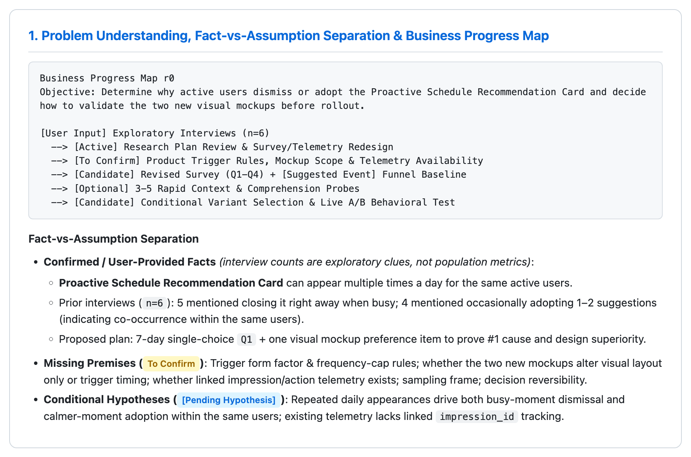
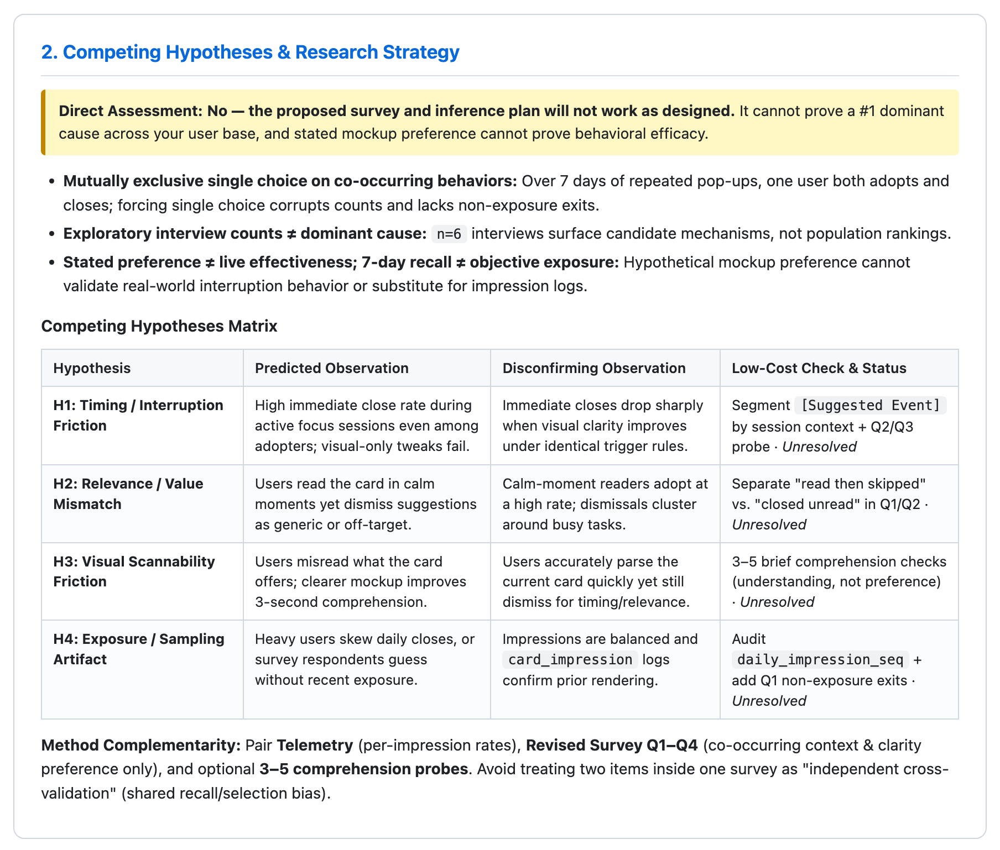
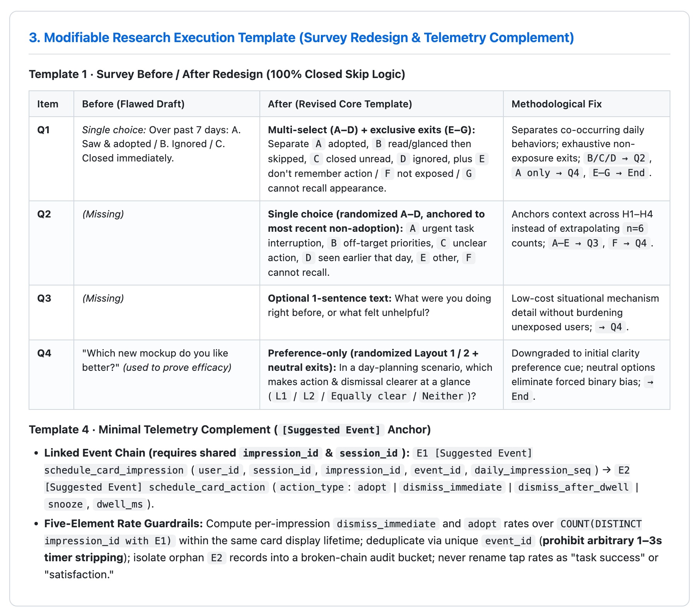
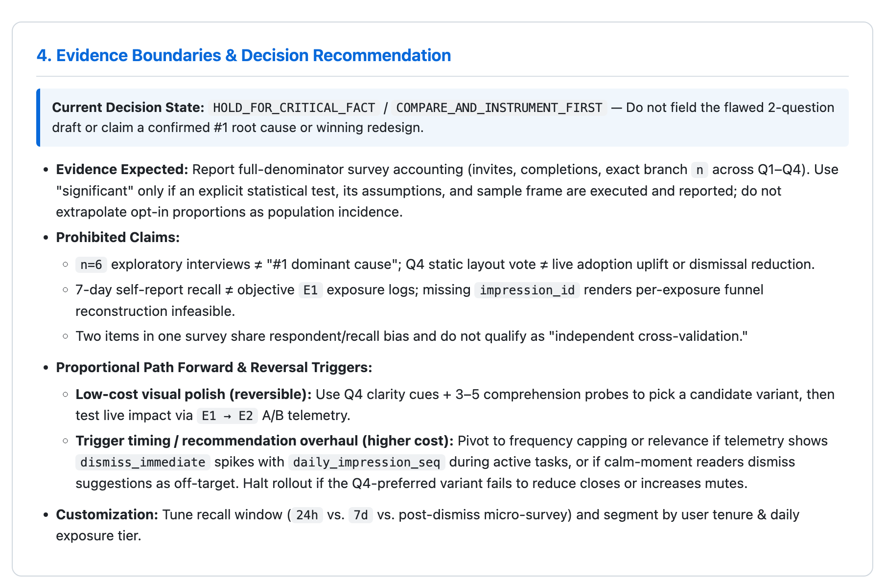

# UXDA — User Experience Decision Assistant (Public Core v0.1.0-beta.2)

English | [简体中文](README.zh-CN.md)

[](#license)
[-orange.svg)](#version-mapping--release-identity)
[](#architecture--clean-separation)

---

## 1. What UXDA Is

UXDA (**User Experience Decision Assistant**) is a unified AI agent skill package (`skills/uxda`) for UX research, interaction design review, and human factors reasoning. Through structured methodological framing, evidence boundary checks, and modifiable study instruments, UXDA helps practitioners formulate research questions, examine competing explanations, design low-resource research pilots, and evaluate design trade-offs.

UXDA is a **structured reasoning and decision-support tool**, not an empirical research substitute or automated certification authority.

> ### ⚠️ Critical Professional & Safety Disclaimer
> - UXDA outputs are **conditional proposals for discussion**, never finalized corporate resolutions, legal clearances, or engineering approvals.
> - UXDA **does not replace qualified human experts**, empirical user research, regulatory approvals (e.g., FDA, FAA, EU MDR), technical standards certification (e.g., ISO, GB), or physical/safety testing.
> - **Host Platform Scope**: UXDA consists solely of local Markdown skill instructions, reference protocols, and Python standard-library scripts (`local_evidence.py` supports optional external `.docx`/`.xlsx`/`.pdf` parsers if installed). Network transmission, LLM inference, and session retention depend entirely on your host AI agent platform (see [SECURITY.md](SECURITY.md)).

<a id="architecture--clean-separation"></a>
<a id="architecture"></a>
### Architecture & Clean Separation

UXDA follows a **Standalone-First, Interoperable-by-Design** layout separating the **Public Core** from optional private extensions:

```text
UXDA Public Core
    │
    ├── skills/uxda/SKILL.md (Unified Single-Skill Entrypoint)
    │       ├── Guided     (Methodology learning, construct & bias explanation)
    │       ├── Decision   (Design trade-offs, competing hypotheses & reversal triggers)
    │       ├── Project    (Study protocols, modifiable execution templates & telemetry audits)
    │       └── Specialist (Direct ergonomic geometry, hitbox bounds & friction review)
    │
    ├── skills/uxda/references/ (On-demand methodology, execution templates & standards)
    ├── skills/uxda/scripts/    (Offline Python verification, audit & evidence tools)
    │
    └── Optional External Context Bundle Contract (v0.2 Generic Specification)
            └── User-Maintained Private Extensions (Proprietary rules & data, kept outside repo)
```

<a id="version-mapping--release-identity"></a>
<a id="versioning"></a>
### Version Mapping & Release Identity

| Component / Layer | Public Version | Evolution Track | Role & Scope |
| :--- | :---: | :---: | :--- |
| **UXDA Public Core Suite** | **`v0.1.0-beta.2`** | *Source-Available Public Beta* | Unified distribution of skill, methodology references, scripts, and guides |
| `skills/uxda` (Unified Skill) | `v0.1.0-beta.2` | Consolidated Router (v0.5.4) + Specialist (v0.7.0) | Single entrypoint delivering Guided, Decision, Project, and Specialist workflows |
| Context Bundle Contract | `v0.2` | Generic Specification v0.2 | Optional JSON interchange specification (no bundled enterprise backend) |

---

## 2. Core Capabilities

No separate skills, custom slash commands, or hosted APIs are required. UXDA routes natural-language requests across four internal capabilities within `skills/uxda/SKILL.md`:

| Capability | Intended Use | Representative Output |
| :--- | :--- | :--- |
| **`Guided`** | Learning UX research methods, bias control, construct validity, and where to start | Problem framing, methodological rationale, applicability trade-offs, and guided practice |
| **`Decision`** | High-stakes product/UX trade-offs, error-mode critique, and decision framing | Competing hypotheses, reversal triggers, conditional choices (`Keep` / `Do Minimum` / `Pilot` / `Hold`) |
| **`Project`** | Study planning, low-resource research pilots, survey/interview redesign, and telemetry sanity checks | Modifiable execution templates (`research-execution-templates.md`), 5-element metric definitions, and broken-chain guards |
| **`Specialist`** | Direct human-factors, physical display/touch sizing, and interaction friction review (no questionnaire blocker) | Reproducible geometric math (under explicit scaling assumptions), hitbox vs. visual bounds, and ergonomic risk checks |

---

## 3. What's New in `v0.1.0-beta.2`

`v0.1.0-beta.2` transitions UXDA from pure methodology recommendations to **execution enablement** with hardened epistemic and measurement guardrails:

- **Added Modifiable Research Execution Templates** ([research-execution-templates.md](skills/uxda/references/research-execution-templates.md), Templates 1–5): Structured survey, qualitative interview, usability testing, behavioral telemetry event chains, and **low-resource / constrained research pilot** strategies—with explicit research rationale, customizable parameters, evidence limits, and decision links.
- **Fact vs. Assumption Gate**: Strictly separates `(a) confirmed user-provided facts`, `(b) missing premises (To Confirm)`, and `(c) [Pending Hypothesis]` before locking study objects or metrics—preventing inferred product capabilities from being presented as established facts.
- **Survey & Qualitative Rigor**: Prohibits stuffing co-occurring behaviors (e.g., adopt, ignore, dismiss over 7 days) into mutually exclusive single-choice items; requires closed skip logic; forbids elevating exploratory small-sample interview counts into population "dominant cause" rankings or treating static mockup preference as validated live effectiveness.
- **Behavioral Telemetry Integrity**: Separates entry CTR, result CTR, task success rate, and subjective satisfaction; prohibits renaming proxy click ratios as "task success" or "satisfaction"; prohibits mechanical 1–3s interval deduplication (prioritizes unique `event_id`, `impression_id`/`session_id`, and interaction semantics).
- **Method Complementarity & Proportionate Gating**: Distinguishes method complementarity, shared recall/selection bias, and independent replication; calibrates verification bars to evidence strength, decision risk, cost, and reversibility rather than mechanically blocking low-risk reversible fixes.

---

## 4. Representative Workflow Example (`Case TC-01`)

To demonstrate an end-to-end UXDA `v0.1.0-beta.2` reasoning chain rather than disconnected snippets, the four cropped panels below come from **a single continuous `TC-01` run** (faithfully localized Chinese versions of the same four panels are used in [README.zh-CN.md](README.zh-CN.md)):

> **Scenario Prompt (`TC-01`):**
> *"We built a 'Proactive Schedule Recommendation Card' inside our productivity app (it can pop up or appear multiple times a day for the same active users). Earlier we ran exploratory interviews with 6 users (5 casually mentioned 'often closing it right away when busy,' and 4 mentioned 'occasionally adopting one or two suggestions'). I want to send a minimal survey: Q1 (single choice) 'Over the past 7 days, what did you do with the proactive recommendation card? A. Saw and adopted / B. Ignored without looking / C. Closed immediately,' plus one question showing users two new visual mockups to pick which one they like better—and use the results to prove the #1 dominant cause from our interviews and prove the new mockup works better. Does this work? Please give revision recommendations and a minimal execution framework."*

### Step-by-Step Excerpts from One Continuous `TC-01` Output

#### Panel 1 · Problem Understanding & Business Progress Map

<a href="docs/media/demos/tc01-1-progress.png"></a>

- *English Caption:* **Panel 1 — Problem Framing & Business Progress Map (`r0`):** Captures the current workflow stage (`[Active] Research Plan Review`), next conditional milestones, and explicit separation of confirmed inputs (`n=6` co-occurring interview clues), `To Confirm` product premises, and `[Pending Hypothesis]` assumptions.
- *中文图注：* **图 1 — 问题理解、事实与假设分离及业务推进图（`r0`）：** 呈现当前所处研究评审阶段、条件性推进节点，以及将“已知事实（6 人访谈中的行为共存线索）”“缺失前提（`To Confirm`）”与“`[Pending Hypothesis]`”严格隔离的前置校验。

#### Panel 2 · Competing Hypotheses & Research Strategy

<a href="docs/media/demos/tc01-2-hypotheses.png"></a>

- *English Caption:* **Panel 2 — Competing Hypotheses (`H1–H4`) & Method Complementarity:** Explains why the original single-choice Q1 + static mockup vote fails, maps four rival explanations (Timing/Interruption, Relevance Mismatch, Visual Scannability, Exposure/Measurement Artifact) with disconfirming observations, and pairs telemetry with survey/comprehension checks while flagging shared-bias limits.
- *中文图注：* **图 2 — 竞争性假设矩阵（`H1–H4`）与方法互补策略：** 指出原互斥单选与静态图偏好无法成立的四处方法学缺陷，给出 4 条竞争性解释（打断时机、相关性偏差、可读性摩擦、曝光/抽样伪影）及各自证伪条件，并明确行为日志、修订问卷与轻量理解测试的互补边界。

#### Panel 3 · Modifiable Execution Templates (Survey & Telemetry)

<a href="docs/media/demos/tc01-3-template.png"></a>

- *English Caption:* **Panel 3 — Execution Templates (Before/After Survey + `[Suggested Event]` Telemetry):** Rebuilds Q1 into a multi-select item separating co-occurring behaviors with exclusive non-exposure exits (`E–G`), anchors Q2/Q3 to the most recent non-adoption event, downgrades Q4 to a randomized preference-only clarity cue, and defines linked `impression_id` telemetry avoiding arbitrary 1–3s dedup.
- *中文图注：* **图 3 — 可修改研究执行模板（问卷前后对比 + `[Suggested Event]` 埋点方案）：** 将 Q1 改写为可并存多选加互斥未曝光出口（`E–G`），将 Q2/Q3 锚定至最近一次未采纳情境，将 Q4 降级为仅测清晰度偏好的随机化选项，并补充基于 `impression_id` 与 `event_id` 去重的最小事件链（禁用 1–3 秒粗暴删重）。

#### Panel 4 · Evidence Boundaries & Decision Recommendation

<a href="docs/media/demos/tc01-4-boundaries.png"></a>

- *English Caption:* **Panel 4 — Evidence Boundaries & Decision Recommendation:** Sets `HOLD_FOR_CRITICAL_FACT / COMPARE_AND_INSTRUMENT_FIRST`, lists prohibited claims (small-sample prevalence extrapolation, preference as efficacy, recall as exposure, two survey items as independent validation), and defines proportional next actions and reversal triggers.
- *中文图注：* **图 4 — 证据边界与决策建议：** 明确当前状态为待确认关键前提后再部署实验，列明禁用结论（小样本外推总体排名、主观偏好替代上线效果、自报替代客观曝光、同源问卷充当独立交叉验证），并给出按风险与可逆性分级的下一步动作及逆转条件。

### Screenshot-to-Capability Mapping

| Screenshot | Focus Region | UXDA Capabilities Demonstrated |
| :--- | :--- | :--- |
| [Panel 1](docs/media/demos/tc01-1-progress.png) | Problem Framing & Progress Map | **Workflow Tracking (`business-progress-map`) & Fact-vs-Assumption Gate**: Prevents unverified trigger/telemetry assumptions from becoming project facts. |
| [Panel 2](docs/media/demos/tc01-2-hypotheses.png) | Competing Hypotheses & Strategy | **Decision & Analytical Quality (`H1–H4`, Method Complementarity)**: Blocks premature "dominant cause" claims and separates complementary signals from shared bias. |
| [Panel 3](docs/media/demos/tc01-3-template.png) | Survey & Telemetry Instruments | **Project Execution Templates (`Template 1` + `Template 4`)**: Generates editable Q1–Q4 closed skip logic and `[Suggested Event]` 5-element metric guardrails. |
| [Panel 4](docs/media/demos/tc01-4-boundaries.png) | Evidence Boundaries & Decision Link | **Evidence Boundaries & Proportionate Decision Gating**: States prohibited inferences, ownership limits, and exact reversal triggers for pilot vs. live rollout. |

---

## 5. Best Fit & Non-Goals

| Best Suited For (Supported Today) | Not Suited For / Non-Goals |
| :--- | :--- |
| Structured problem framing, competing-hypothesis analysis, and UX methodology learning (`Guided` / `Decision`) | Replacing empirical user testing, production telemetry, or qualified human factors experts |
| Designing and auditing **low-resource research pilots**, survey wording, interview probes, and telemetry event chains (`Project`) | Extrapolating convenience surveys or small qualitative samples (`n=3–6`) into population prevalence or rankings |
| Fast, direct ergonomic geometry math and interaction-friction walkthroughs without blocking questionnaires (`Specialist`) | Statutory safety certification, legal sign-off, medical/automotive compliance approval, or physical lab verification |
| Offline local-document evidence retrieval (`local_evidence.py`) and user-confirmed Markdown/H5 briefs | Built-in GUI consoles, automated rule repositories, live network telemetry collection, or guaranteed cross-host auto-discovery |

---

## 6. Quick Start

### 1. Install `skills/uxda` (macOS / Linux)

UXDA is an **agent skill package, not a standalone application**. Your AI host must support reading local `SKILL.md` files.

```bash
git clone https://github.com/RagnTec/User-Experience-Decision-Assistant.git
cd User-Experience-Decision-Assistant
mkdir -p ~/.agents/skills
cp -R skills/uxda ~/.agents/skills/

# Verify entry file
test -f ~/.agents/skills/uxda/SKILL.md
```

**Optional Google Antigravity discovery link (verified environment example):**

```bash
mkdir -p ~/.gemini/config/skills
ln -s ~/.agents/skills/uxda ~/.gemini/config/skills/uxda
```

> **Note:** Check for an existing directory or symlink before running `ln -s`. This path is an example from the tested environment, **not a universal path guaranteed for Claude Code, Cursor, Codex, or Gemini CLI**. **While the repository remains Private, cloning requires GitHub access.**

### 2. Invoke UXDA via Natural Language

- **Guided (Methodology & Problem Framing):**
  `Use the installed uxda skill: Shoppers seem to miss our product filter in a shopping app. How should we separate discovery gaps from low user intent before launching a survey?`
- **Decision (Trade-offs & Reversal Conditions):**
  `Use the installed uxda skill: Compare removing the confirmation dialog before bulk file deletion vs. making deletion reversible with Undo. Highlight cognitive slip risks and reversal gates.`
- **Project (Execution Templates & Low-Resource Pilot):**
  `Use the installed uxda skill: Give me a modifiable 4-item interview guide and a [Suggested Event] telemetry check to diagnose onboarding drop-off under a tight 1-week pilot budget.`
- **Specialist (Direct Ergonomic Review — No Questionnaire Blocker):**
  `Use the installed uxda skill: On a 10.1-inch 1280×800 industrial touchscreen, evaluate 36×36 px buttons for operators wearing thin gloves.`
- **With Local Documents (Offline Manifest Search):**
  See [Local Knowledge & Evidence Layer](skills/uxda/references/local-knowledge-evidence.md) for using `python3 skills/uxda/scripts/local_evidence.py` with an explicit local manifest—kept strictly outside the Public Core repository.

---

## 7. Limitations & Boundaries

- **Known Beta Limitation (Standards & Quantitative Thresholds):** Specific external standard clause citations and uncalibrated quantitative thresholds remain subject to model/reference errors; critical human-factors, safety, and compliance judgments must be verified against authoritative primary standards and real-device testing.
- **Epistemic & Measurement Boundaries:**
  - Qualitative samples and convenience/opt-in surveys cannot establish population-level incidence or "#1 root causes."
  - Stated preference for static mockups does not validate real-world behavioral efficacy.
  - Proxy click-through ratios (such as `result clicks / home impressions`) must never be mislabeled as "task success rate" or "user satisfaction," and missing `session_id`/`impression_id` prevents per-exposure funnel reconstruction.
- **Host Platform Compatibility Scope:** Installation, discovery symlinks, and live skill runs have been verified only in the local `~/.agents/skills/uxda` + Antigravity setup. Cross-host discovery and behavior on **Claude Code, Cursor, Codex, Gemini CLI**, and external skill hubs (**SkillX, Tencent SkillHub**) have **not** been verified in live end-to-end tests; follow [INSTALLATION.md](INSTALLATION.md) for host-specific path binding.

---

## 8. Installation, Documentation & License

### Documentation Index

- [Installation Guide](INSTALLATION.md) — Setup steps, offline script verification, and host compatibility scope.
- [Quick Start Guide](QUICK_START.md) — 5-minute hands-on walkthrough across all four capabilities.
- [Methodology & Limitations](LIMITATIONS.md) — Detailed epistemological rules, sample limits, and non-goals.
- [Release Notes](RELEASE_NOTES.md) — `v0.1.0-beta.2` changelog, `v0.1.0-beta.1` baseline, and verification scope.
- [Security & Privacy](SECURITY.md) — Data isolation boundaries, local-script confinement, and reporting guidance.
- [Contributing Guidelines](CONTRIBUTING.md) — Feedback workflow and Public Core boundary rules.

<a id="license"></a>
<a id="license-review"></a>
### License & Beta Usage Guidance

UXDA Public Core is distributed as **source-available software under the [PolyForm Strict License 1.0.0](LICENSE)** ([polyformproject.org](https://polyformproject.org/licenses/strict/1.0.0)).

Use is permitted within the non-commercial / permitted bounds specified by the license; commercial use, modification, and redistribution require separate authorization from the maintainer. At this Beta stage, UXDA is intended for learning, research, evaluation, and experimental use—not unreviewed production deployment or sole reliance for high-consequence decisions. Feedback and bug reports are welcome via [GitHub Issues](https://github.com/RagnTec/User-Experience-Decision-Assistant/issues).
