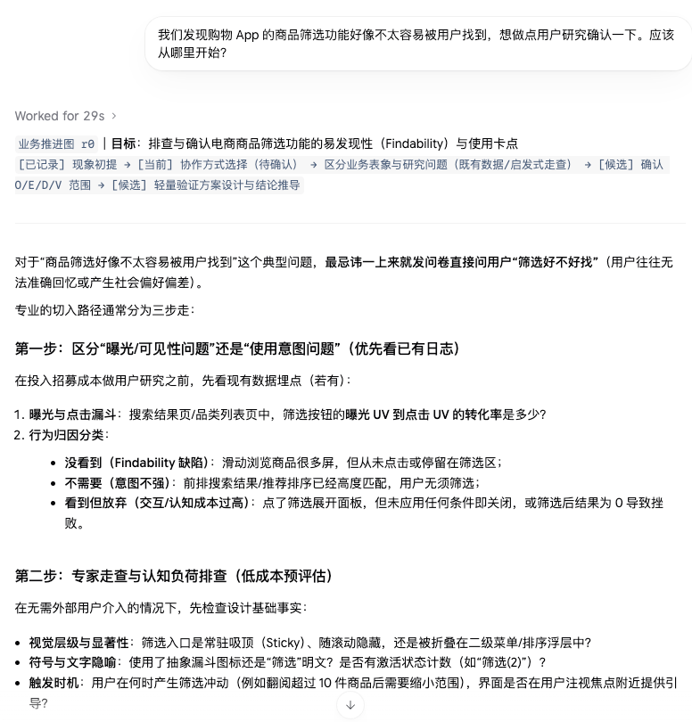
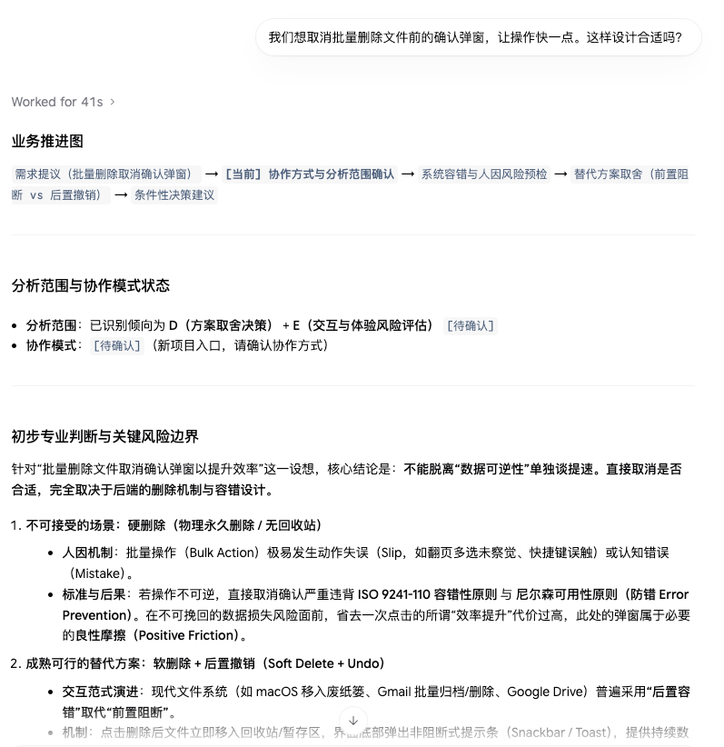
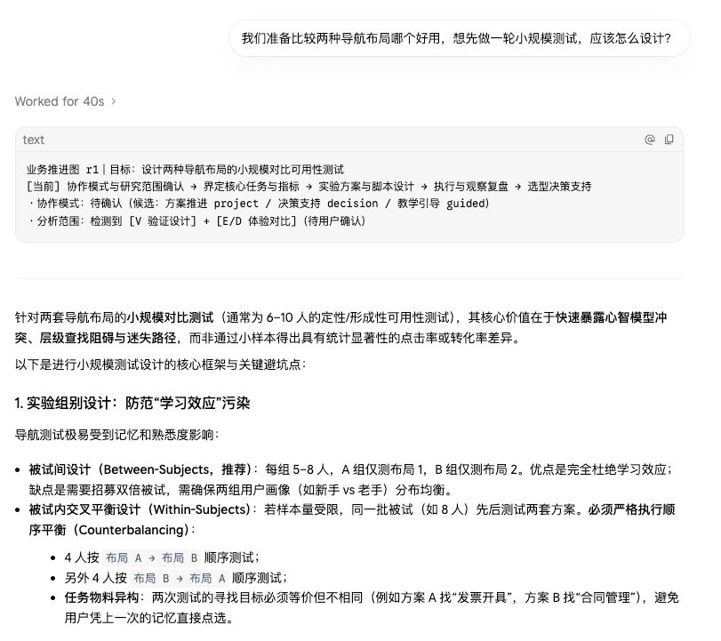
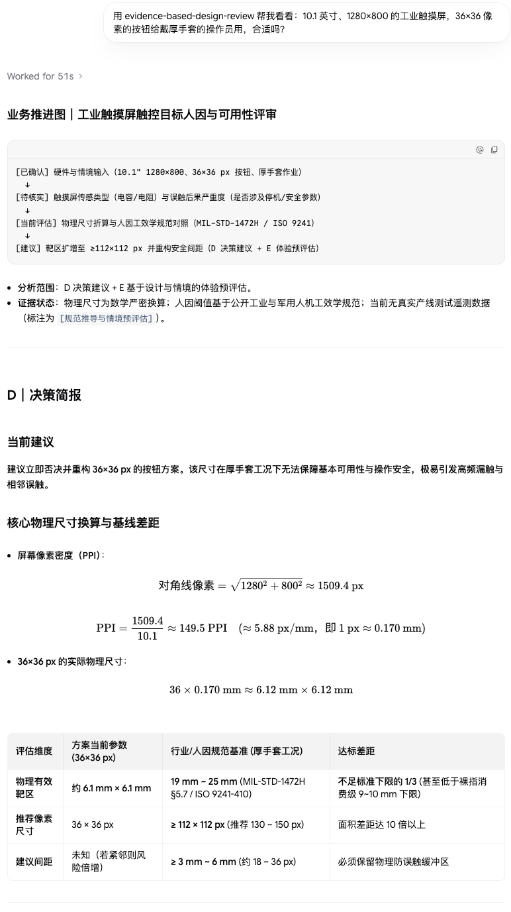

# UXDA — User Experience Decision Assistant (Public Core v0.1.0-beta.1)

English | [简体中文](README.zh-CN.md)

[](#license)
[-orange.svg)](#version-mapping--release-identity)
[](#architecture--clean-separation)

UXDA (User Experience Decision Assistant) is an AI agent skill suite for UX research, interaction design, and human factors. Through professional knowledge exchange, methodological guidance, and scenario-based practice, it helps users frame research questions, explore alternative explanations, choose appropriate methods, and progressively develop independent research capabilities.

UXDA can help users formulate hypotheses, examine evidence, plan studies, and discuss preliminary recommendations. It does not replace empirical user research or professional judgment. Its outputs are intended for learning, discussion, and further validation, not as established user insights or validated research findings.

---

> ### ⚠️ Critical Professional & Safety Disclaimer
> **UXDA is a structured reasoning and decision-support tool, NOT an automated certification authority.**
> - UXDA outputs are **conditional proposals for discussion (拟议审议建议)**, never finalized corporate resolutions, legal clearances, or engineering change approvals.
> - UXDA does **not replace qualified professional human judgment**, approvals by government regulatory agencies (e.g., US FDA, FAA), statutory regulations compliance (e.g., EU MDR), consensus technical standards certifications (e.g., ISO, national GB standards), or specialized physical/thermal/electrical/crash testing.
> - High-consequence safety decisions (medical devices, automotive cockpits, industrial appliances) must always be reviewed and approved by certified human domain experts.
> - **Host Platform Scope**: UXDA consists of instruction files, structured reference cards, and local Python validation utilities. The underlying network transmission, model inference, and conversational session management are governed entirely by your host AI agent platform.

---

<a id="architecture--clean-separation"></a>
<a id="architecture"></a>
## 🏛️ Architecture & Clean Separation

UXDA is built on the **Standalone-First, Interoperable-by-Design** principle, maintaining a strict physical and conceptual separation between its **Public Core** and optional enterprise extension mechanisms:

```
+-------------------------------------------------------------------------+
|                        UXDA PUBLIC CORE (This Repo)                     |
|                                                                         |
|  [Router Skill: ux-decision-assistant-router (v0.5.4-beta.1)]             |
|   - Task classification (Guided Learning / Decision / Project Review)   |
|   - Single-Gate pre-flight verification & Business Progress Mapping     |
|   - Evidence taxonomy & methodology boundary enforcement                |
|                                                                         |
|  [Specialist Skill: evidence-based-design-review (v0.7.0-beta.1)]          |
|   - Independent direct-invocation design review                         |
|   - Human factors failure modes (Norman Action Slips, Fitts's Law)      |
|   - Trade-off analysis, competing hypotheses, & Poka-Yoke alternatives  |
|                                                                         |
|  [Public Methodology References & Generic Knowledge Models]             |
|   - ISO 9241, KLM/GOMS calibration rules, cognitive heuristics          |
+-------------------------------------------------------------------------+
                                    │
                                    │ (Optional Context Bundle v0.2 Contract)
                                    ▼
+-------------------------------------------------------------------------+
|                    PRIVATE EXTENSIONS (User-Maintained)                 |
|                                                                         |
|  - Proprietary company rules & internal design systems                  |
|  - Private project registries, document storage, & bindings             |
|  - Confidential telemetry, internal user research records, & approvals  |
|                                                                         |
|  *Note: Public Core operates standalone on user-provided context.       |
+-------------------------------------------------------------------------+
```

---

<a id="version-mapping--release-identity"></a>
<a id="versioning"></a>
## 🏷️ Version Mapping & Release Identity

UXDA Public Core begins its public semantic versioning lifecycle at `v0.1.0-beta.1` (Source-Available Public Beta), while individual modular skills preserve their internal component development version histories:

| Component / Distribution Layer | Public Release Version | Component Evolution Track | Role & Purpose |
| :--- | :---: | :---: | :--- |
| **UXDA Public Core Suite** | **`v0.1.0-beta.1`** | *Source-Available Public Beta* | Unified source-available distribution of the UXDA agent skills |
| `skills/ux-decision-assistant-router` | `v0.5.4-beta.1` | v0.1.0 → v0.5.4-beta.1 | Workflow entry point, task routing, & progress visualization |
| `skills/evidence-based-design-review` | `v0.7.0-beta.1` | v0.1.0 → v0.7.0-beta.1 | Standalone interaction & ergonomic design review specialist |
| External Context Bundle Contract | `v0.2` | Specification v0.2 | Decoupled JSON data exchange schema for optional extensions |

---

## 📦 What's Included in the Public Beta

| Component | Path | Description |
| :--- | :--- | :--- |
| **Router Skill** | `skills/ux-decision-assistant-router` | Main conversational entrypoint. Gathers problem framing, maps business stages, enforces evidence boundaries, and guides O/E/D/V research routes. |
| **Specialist Skill** | `skills/evidence-based-design-review` | Focused design reviewer. Evaluates wireframes, UI changes, hardware panels, and workflows against cognitive and physical ergonomics. |
| **Single-Gate References** | `skills/*/references/` | Core epistemological guides: `analytical-quality.md`, `evidence-boundaries.md`, `design-integration-baseline.md`. |
| **Documentation & Guides** | Root (`*.md`) | Standalone setup guides, synthetic walk-throughs, and methodology boundary definitions. |

---

## 🚀 Install, Invoke, and Explore

### 1. Install the two skills (macOS / Linux)

UXDA is an **agent skill package, not a standalone app**. You need an AI agent that can read local skill files. The commands below install both public skills; they do not install an LLM, run a service, or guarantee that every host will discover the skills automatically.

```bash
git clone https://github.com/RagnTec/User-Experience-Decision-Assistant.git
cd User-Experience-Decision-Assistant
mkdir -p ~/.agents/skills
cp -R skills/ux-decision-assistant-router ~/.agents/skills/
cp -R skills/evidence-based-design-review ~/.agents/skills/

# Verify the two entry files exist
test -f ~/.agents/skills/ux-decision-assistant-router/SKILL.md
test -f ~/.agents/skills/evidence-based-design-review/SKILL.md
```

**Google Antigravity (optional discovery links, if required by your setup):**

```bash
mkdir -p ~/.gemini/config/skills
ln -s ~/.agents/skills/ux-decision-assistant-router ~/.gemini/config/skills/ux-decision-assistant-router
ln -s ~/.agents/skills/evidence-based-design-review ~/.gemini/config/skills/evidence-based-design-review
```

Check for an existing link or folder before running `ln -s` again. This is a setup example from the tested environment, **not a universal installation path** for Gemini CLI, Claude Code, Cursor, or every agent host. Consult [INSTALLATION.md](INSTALLATION.md) and your host's skill-discovery settings. **While this repository is Private, cloning requires GitHub access to it.**

### 2. Invoke a skill in your agent chat

There is **no UXDA-specific slash command or hosted API** in this beta. In a compatible agent session, use an explicit natural-language prompt. Skill discovery and actual tool/file access depend on your host.

**Router (guided learning / decision support / project work)**

```text
Use the installed ux-decision-assistant-router skill for this task.
Choose decision mode. Compare two ways of handling an accidental bulk-delete:
(a) a confirmation dialog; (b) reversible deletion with Undo.
Explain the trade-offs, assumptions, and what evidence would change the recommendation.
If the skill is not accessible, tell me instead of pretending it was loaded.
```

**Direct Specialist (focused design review, without starting the Router workflow)**

```text
Use the installed evidence-based-design-review skill directly.
Evaluate the interaction risks of these two interface variants for the
specified task. Separate observable design facts, human-factors inference,
and unknown conditions. Recommend only actionable next steps.
If you cannot access the skill, report that limitation.
```

If your host cannot auto-discover a skill, point it to the corresponding `SKILL.md` in the installed folder **only if the host supports reading local files**. You can also paste a sanitized design description directly; no private extension or company project data is required.

### 3. Generic Demonstrations

The following screenshots show actual UXDA outputs in Antigravity across simulated business scenarios, displaying selected excerpts. UXDA is currently in Beta; its analytical performance and professional judgments have not been fully validated. It is recommended for exploration, learning, and decision support—critical conclusions still require manual human review.

<details>
<summary><strong>Case 1 · Research Question Framing (Router)</strong></summary>

**Original user prompt (Chinese):**

```text
我们发现购物 App 的商品筛选功能好像不太容易被用户找到，想做点用户研究确认一下。应该从哪里开始？
```

*English translation: "We noticed shoppers seem to have trouble finding the product filter in our shopping app and want to run some user research to check. Where should we start?"*

<a href="docs/media/demos/demo1.png"></a>

**Capabilities & boundaries**: Breaks down ambiguous experience problems into competing explanatory hypotheses, offering initial research directions and follow-up collaboration choices.

</details>

<details>
<summary><strong>Case 2 · Design Decision Support (Router)</strong></summary>

**Original user prompt (Chinese):**

```text
我们想取消批量删除文件前的确认弹窗，让操作快一点。这样设计合适吗？
```

*English translation: "We want to remove the confirmation dialog before bulk-deleting files to make operations faster. Is this design appropriate?"*

<a href="docs/media/demos/demo2.png"></a>

**Capabilities & boundaries**: Identifies critical conditions governing design trade-offs, analyzes potential interaction risks, and proposes preliminary alternative approaches.

</details>

<details>
<summary><strong>Case 3 · Research Planning Support (Router)</strong></summary>

**Original user prompt (Chinese):**

```text
我们准备比较两种导航布局哪个好用，想先做一轮小规模测试，应该怎么设计？
```

*English translation: "We want to compare which of two navigation layouts is easier to use and plan to run a small pilot test first. How should we design it?"*

<a href="docs/media/demos/demo3.png"></a>

**Capabilities & boundaries**: Outlines test design directions aligned with research goals and highlights experimental controls like learning effects and task sequencing.

</details>

<details>
<summary><strong>Case 4 · Touch Target Review (Specialist · ⚠️ Known Beta Limitation)</strong></summary>

**Original user prompt (Chinese):**

```text
用 evidence-based-design-review 帮我看看：10.1 英寸、1280×800 的工业触摸屏，36×36 像素的按钮给戴厚手套的操作员用，合适吗？
```

*English translation: "Review this with evidence-based-design-review: for a 10.1-inch 1280×800 industrial touchscreen, are 36×36 px buttons suitable for operators wearing thick gloves?"*

**Limitations & boundaries**:
`Known Beta Limitation`: Professional standard citations and design thresholds may contain inaccuracies; critical human-factors, safety, and compliance judgments require manual expert verification.

<a href="docs/media/demos/demo4.png"></a>

</details>

**Want a visual report?** If your host allows local file writing, you may additionally ask: `After the review, offer an HTML/H5 summary. Create it only after I approve the format.` This is an optional presentation workflow, not a guaranteed built-in GUI. No fabricated tool screenshots or metrics are used.

## 📖 Documentation Index

- [Installation Guide](INSTALLATION.md) — Setup across supported Agent platforms and standalone checks.
- [Quick Start Guide](QUICK_START.md) — 5-minute hands-on tutorial with synthetic examples.
- [Methodology & Limitations](LIMITATIONS.md) — Epistemic boundaries, sample size rules, and non-goals.
- [Contributing Guidelines](CONTRIBUTING.md) — How to propose enhancements and add generic knowledge cards.
- [Security & Privacy](SECURITY.md) — Data boundary definitions, host platform distinctions, and vulnerability reporting.
- [Initial Release Notes](RELEASE_NOTES.md) — Changelog and baseline features of `v0.1.0-beta.1`.

---

<a id="license"></a>
<a id="license-review"></a>
## ⚖️ License & Beta Usage Guidance

**UXDA Public Core is currently available as a public beta.**

We welcome individuals, researchers, and eligible organizations to explore UXDA's potential in human factors, user experience research, and interaction design review, and to share their experiences, issues, and suggestions through [GitHub Issues](https://github.com/RagnTec/User-Experience-Decision-Assistant/issues).

As the project is still under active development and validation, some methodological rules, analytical capabilities, and cross-platform integrations have not yet been sufficiently validated in real-world use. **At this stage, UXDA is best suited for learning, research, evaluation, and experimentation. Direct production deployment is not recommended, nor should its outputs serve as the sole basis for critical business, safety, or compliance decisions.**

UXDA is distributed as **source-available software under the [PolyForm Strict License 1.0.0](LICENSE)** ([polyformproject.org](https://polyformproject.org/licenses/strict/1.0.0)). Use is permitted for purposes covered by the license. Commercial use, software modification, and redistribution require separate authorization from the maintainer. Please refer to the repository's `LICENSE` file for the governing terms.

We will continue refining UXDA based on testing and community feedback, and may revisit its licensing and usage policies as the project matures.
