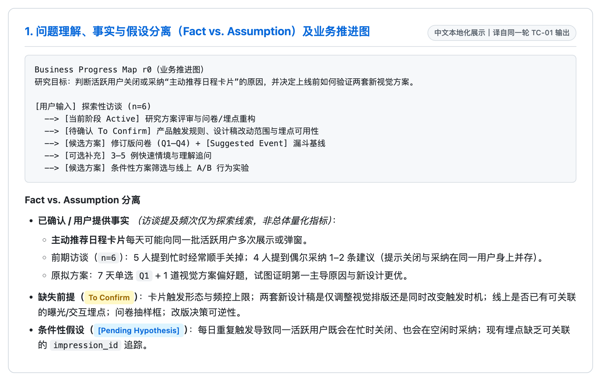
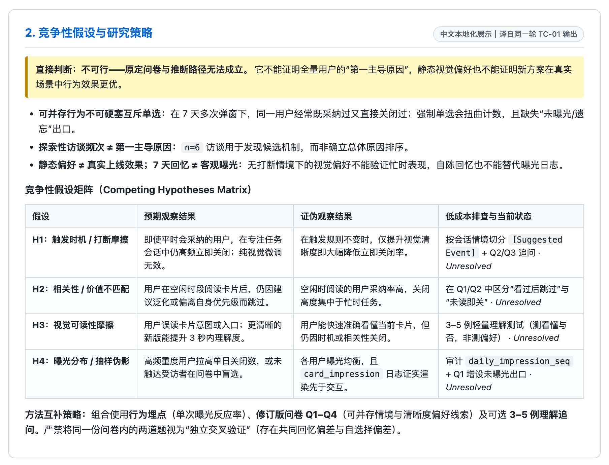
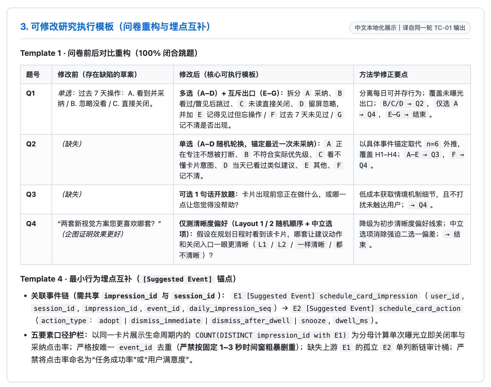
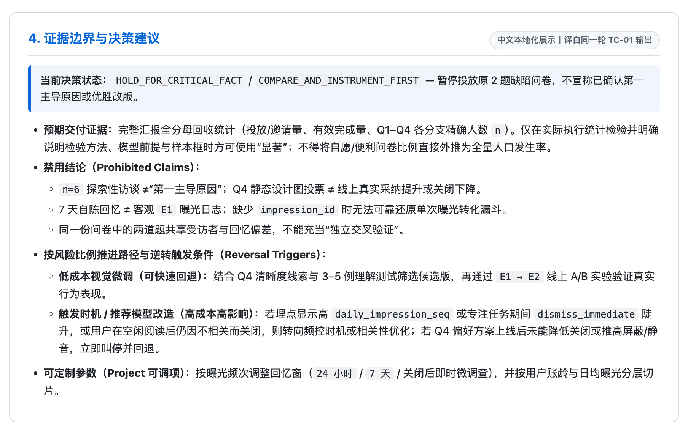

# UXDA — 用户体验决策顾问 (Public Core v0.1.0-beta.3)

[English](README.md) | 简体中文

[](#许可证与使用说明)
[-orange.svg)](#版本映射与发布标识)
[](#架构设计与物理隔离)

---

## 1. UXDA 是什么

UXDA（**User Experience Decision Advisor**）是一套面向用户研究、交互体验与人因工程的统一 AI Agent 技能包（`skills/ux-decision-advisor`）。它通过结构化方法推演、证据边界校验与可修改的研究执行模板，辅助使用者拆解体验问题、构建竞争性假设、设计低资源研究试点（Research Pilot）并评估设计方案取舍。

UXDA 是**结构化推理与决策辅助工具**，不能替代真实用户研究或人类专业评审。

> ### ⚠️ 关键专业职责与安全免责声明
> - UXDA 的所有输出均为**拟议审议建议（Conditional proposals for discussion）**，绝不构成企业最终业务决议、法定合规结论或工程放行批准。
> - UXDA **不能替代合格人类专家的判断**、真实用户实证研究、监管机构审批（如 FDA、FAA、EU MDR）、技术标准合规认证（如 ISO、国家 GB 标准）或专用物理/安全实验测试。
> - **宿主平台范围说明**：UXDA 仅包含本地 Markdown 技能指令、方法参考卡片与 Python 标准库离线脚本（`local_evidence.py` 支持用户自备 `.docx`/`.xlsx`/`.pdf` 可选解析库）。底层网络传输、模型推理与会话留存均由您所使用的宿主 AI Agent 平台控制（详见 [SECURITY.md](SECURITY.md)）。

<a id="架构设计与物理隔离"></a>
<a id="architecture"></a>
### 架构设计与物理隔离

UXDA 遵循“**独立优先、设计即互通**”原则，将**公共核心（Public Core）**与可选私有扩展严格分离：

```text
UXDA 公共核心 (Public Core)
    │
    ├── skills/ux-decision-advisor/SKILL.md (统一单技能入口)
    │       ├── Guided     (用研方法学习、构念效度与偏差控制引导)
    │       ├── Decision   (设计方案取舍、竞争性假设与逆转条件)
    │       ├── Project    (调研设计、可修改执行模板与埋点口径审计)
    │       └── Specialist (直达人因工效、触控热区与界面摩擦专项评审)
    │
    ├── skills/ux-decision-advisor/references/ (按需渐进加载的方法规约、执行模板与标准边界)
    ├── skills/ux-decision-advisor/scripts/    (离线 Python 校验、质量审计与本地证据定位工具)
    │
    └── 可选外部 Context Bundle 契约 (v0.2 通用接口规范)
            └── 用户自建私有扩展 (企业专属规则与研究资料，严禁写入本仓库)
```

<a id="版本映射与发布标识"></a>
<a id="versioning"></a>
### 版本映射与发布标识

| 组件 / 分发层级 | 公开版本号 | 组件演进追踪 | 角色与范围说明 |
| :--- | :---: | :---: | :--- |
| **UXDA Public Core 套件** | **`v0.1.0-beta.3`** | *源码公开受限测试版 (Source-Available Beta)* | 技能包、方法参考库、离线脚本与文档的统一分发版本 |
| `skills/ux-decision-advisor`（统一核心技能） | `v0.1.0-beta.3` | 原 Router (v0.5.4) + Specialist (v0.7.0) 一体化整合 | 对外唯一入口，集成 Guided / Decision / Project / Specialist 四类能力 |
| Context Bundle 接口契约 | `v0.2` | 通用接口规范 v0.2 | 可选 JSON 数据交换约定（仓库内不含企业私有后端实现） |

---

## 2. 核心能力（Guided / Decision / Project / Specialist）

无需安装多个独立技能，也无专用斜杠命令或托管 API。在支持加载本地 Skill 的 Agent 会话中，UXDA 会按自然语言意图自动调度 `skills/ux-decision-advisor/SKILL.md` 内部四类能力：

| 核心能力 | 适用任务场景 | 典型输出物 |
| :--- | :--- | :--- |
| **`Guided`** | 学习用研方法、梳理研究起点、理解构念效度与测量偏差控制 | 问题拆解路径、方法原理说明、适用条件取舍与引导练习 |
| **`Decision`** | 关键体验改版取舍、交互防错风险评估、是否需要投入研究的判断 | 竞争性假设推演、条件性方案结论（保留 / 最小改动 / 试跑 / 暂缓）与逆转触发条件 |
| **`Project`** | 调研方案设计、**低资源 Research Pilot**、问卷/访谈提纲改写、行为日志口径核查 | 可修改研究执行模板（`research-execution-templates.md`）、指标五要素口径与断链审计 |
| **`Specialist`** | 人因工效、屏幕点距与触控热区评估、界面交互摩擦走查（**直接评审，无前置问卷阻塞**） | 可复算几何尺寸推演（明示缩放前提）、视觉边框与触控热区区分、可恢复性建议 |

---

## 3. `v0.1.0-beta.3` 命名与分发更新

本版本将正式英文名称统一为 **User Experience Decision Advisor（UXDA）**，中文名称为**用户体验决策顾问**，Skill ID 改为 **`ux-decision-advisor`**。保留原 GitHub 仓库地址与既有 Beta Tag，Guided / Decision / Project / Specialist 四类能力逻辑不因本次改名而改变。

```bash
npx skills add RagnTec/User-Experience-Decision-Assistant --skill ux-decision-advisor
```

原 `uxda` 安装不会自动迁移，升级操作请参考 [INSTALLATION.md](INSTALLATION.md)。

### 历史版本：`v0.1.0-beta.2`


`v0.1.0-beta.2` 在保持单一 Skill 架构不变的基础上，将能力从“推荐研究方法”延伸至“**可直接修改落地的执行方案与方法学边界防护**”：

- **新增研究执行模板库**（[research-execution-templates.md](skills/ux-decision-advisor/references/research-execution-templates.md)，涵盖 `Template 1–5`）：提供结构化问卷、半结构化访谈、可用性测试、行为埋点事件链及**低资源 / 受限 Research Pilot** 策略，每项模板均附带研究依据、可修改参数、证据边界与决策关联。
- **事实与假设严格分离（Fact vs. Assumption Gate）**：在实例化模板或分析结论前，明确拆分 `(a) 用户已提供事实`、`(b) 缺失前提（待确认）` 与 `(c) [待确认假设]`，防止把推测的产品触发逻辑写成既定事实。
- **问卷与定性研究方法学加固**：禁止将同一用户可并存的行为（如 7 天内既采纳又关闭主动推荐）硬塞入互斥单选；要求全选项跳题闭合；严禁以小样本探索访谈（如 `n=6`）直接判定总体“第一主导原因”，亦不允许将静态设计图偏好直接视为上线效果验证。
- **行为埋点口径防错护栏**：严格区分入口点击率、结果点击率、任务成功率与主观满意度，严禁将代理点击比率直接命名为“搜索成功率”或“用户满意度”；禁止仅以固定 1–3 秒时间窗粗暴删重（优先依据唯一 `event_id`、`impression_id`/`session_id` 及交互重试语义排查）。
- **方法互补与按风险分级放行**：明确区分方法互补、共享偏差（同一问卷内两题或同源便利样本）与独立重复验证；依据证据强度、决策风险、改动成本与可逆性决定验证门槛，避免对低风险可回退微调机械卡死流程。

---

## 4. 代表性工作流示例（`DEMO-01` 连续推演主案例）

> **案例来源与合成数据说明：** `DEMO-01` 中的业务背景、6 名访谈对象及相关行为数量均为**合成测试输入**，不代表真实用户研究结果；以下 Agent 输出来自 UXDA `v0.1.0-beta.2` 的实际运行，中文展示面板为对同一轮英文输出的忠实翻译与重新排版（保留已有图片文件原命名与角标文本），英文原图见 [README.md](README.md)。

> **场景提示词（`DEMO-01` · 主动推荐日程卡片研究方案评审）：**
> 团队在效率应用内上线了“主动推荐日程卡片”（每天可能向同一批活跃用户弹窗或展示多次）。前期对 6 名用户做了探索性访谈（5 人顺带提到“忙时经常顺手关掉”，4 人提到“偶尔也采纳过一两条”）。团队原计划发一份极简两题问卷：`Q1` 单选“过去 7 天你对卡片的操作（A. 看到并采纳 / B. 忽略没看 / C. 直接关闭）”，加 1 题让用户从两套新视觉方案中二选一，并企图用该结果证明访谈里的“第一主导原因”以及证明“新视觉方案效果更好”。

### 同一轮输出的 4 张连续局部裁切

#### 图 1 · 问题理解与业务推进图

<a href="docs/media/demos/tc01-1-progress.zh-CN.png"></a>

*图注：* 展示 `Business Progress Map r0` 状态追踪，并在启动研究前严格分离已确认输入、`To Confirm` 缺失前提与 `[Pending Hypothesis]` 假设。

#### 图 2 · 竞争性假设与研究策略

<a href="docs/media/demos/tc01-2-hypotheses.zh-CN.png"></a>

*图注：* 否定无效的单选归因与偏好推断，构建四条可证伪竞争性假设（`H1–H4`），并结合方法互补原则提示同源偏差限制。

#### 图 3 · 可修改研究执行模板（问卷 + 行为埋点）

<a href="docs/media/demos/tc01-3-template.zh-CN.png"></a>

*图注：* 将缺陷草案改写为拆分可并存行为的 `Q1–Q4` 全闭合问卷，并配套关联 `impression_id` 与禁用 1–3 秒粗暴删重的 `[Suggested Event]` 埋点护栏。

#### 图 4 · 证据边界与决策建议

<a href="docs/media/demos/tc01-4-boundaries.zh-CN.png"></a>

*图注：* 明确全分母与抽样前提边界，禁用小样本外推或静态偏好充当效果验证，并给出按改版风险和可逆性分级的下一步动作与逆转触发条件。

### 截图与能力映射表

| 局部截图 | 重点展示区域 | 对应的 UXDA 核心能力 |
| :--- | :--- | :--- |
| [图 1](docs/media/demos/tc01-1-progress.zh-CN.png) | 问题理解与业务推进图 | **任务推进追踪与事实/假设分离门禁**：防止把未确认的弹窗频控或埋点存在性脑补为既定产品事实。 |
| [图 2](docs/media/demos/tc01-2-hypotheses.zh-CN.png) | 竞争性假设与研究策略 | **Decision 竞争性推演与方法互补**：阻断错误归因，给出可证伪矩阵，区分方法互补与共享偏差。 |
| [图 3](docs/media/demos/tc01-3-template.zh-CN.png) | 执行模板（问卷 + 行为数据） | **Project 执行模板生成（`Template 1` + `Template 4`）**：输出可直接改写的 `Q1–Q4` 闭环题组与 `[Suggested Event]` 五要素护栏。 |
| [图 4](docs/media/demos/tc01-4-boundaries.zh-CN.png) | 证据边界与决策建议 | **证据边界约束与比例式决策放行**：明示禁用结论、团队决策权属及试跑/全量逆转条件。 |

---

## 5. 适用场景与不适用场景

| 适用场景（当前版本支持） | 不适用场景（非目标边界） |
| :--- | :--- |
| 经验问题拆解、竞争性假设梳理与研究方法学习（`Guided` / `Decision`） | 替代真实用户研究、线上日志观测或具备资质的人因领域专家 |
| 设计与审查**低资源 Research Pilot**、问卷措辞、访谈提纲及埋点事件链（`Project`） | 将小样本访谈（`n=3–6`）或便利抽样问卷直接外推为总体占比、显著差异或排名定论 |
| 无需前置问卷的屏幕像素几何换算与触控交互摩擦快速走查（`Specialist`） | 法定安全认证、医疗/车载合规审批、物理/热学/碰撞实验室实测替代品 |
| 结合用户显式授权的本地文档检索（`local_evidence.py`）与按需离线 H5 摘要渲染 | 独立图形控制台、自动同步企业规则库、主动网络抓取或未实测宿主的通用安装保证 |

---

## 6. 快速上手

### 1. 安装 `skills/ux-decision-advisor`（macOS / Linux）

UXDA 是**本地 Agent Skill 技能包，而非独立运行的软件**。您的宿主 AI 智能体需具备读取本地 `SKILL.md` 文件的能力。

```bash
git clone https://github.com/RagnTec/User-Experience-Decision-Assistant.git
cd User-Experience-Decision-Assistant
mkdir -p ~/.agents/skills
cp -R skills/ux-decision-advisor ~/.agents/skills/

# 确认核心入口文件存在
test -f ~/.agents/skills/ux-decision-advisor/SKILL.md
```

**可选 Google Antigravity 发现目录软链接（已实测环境示例）：**

```bash
mkdir -p ~/.gemini/config/skills
ln -s ~/.agents/skills/ux-decision-advisor ~/.gemini/config/skills/ux-decision-advisor
```

> **提示：** 重复执行 `ln -s` 前请先检查目标路径是否已存在。以上路径仅对应已实测环境，**不承诺适用于 Claude Code、Cursor、Codex 或 Gemini CLI 等所有宿主平台**。**在仓库保持 Private 期间，克隆需具备对应 GitHub 访问权限。**

### 2. 对话调用示例

- **Guided（方法学习与问题拆解）：**
  `请使用已安装的 uxda 技能：购物 App 商品筛选似乎难被发现，在发问卷前应如何拆解“没找到”与“不需要”的竞争性假设？`
- **Decision（设计取舍与逆转门禁）：**
  `请使用已安装的 uxda 技能：比较“取消批量删除确认弹窗”与“提供可撤销删除”两种方案的误操作风险、适用条件与逆转触发规则。`
- **Project（执行模板与低成本试点）：**
  `请使用已安装的 uxda 技能：预算和时间仅够一周内做轻量研究 pilot，请给出可修改的 4 题访谈提纲和 [建议事件] 埋点排查方案。`
- **Specialist（直达人因评审，无问卷阻塞）：**
  `请使用已安装的 uxda 技能：10.1 英寸 1280×800 工业触摸屏，36×36 像素按钮给戴薄手套的操作员使用，合适吗？`
- **结合本地私有文档（离线清单检索）：**
  参见 [本地知识与证据层说明](skills/ux-decision-advisor/references/local-knowledge-evidence.md)，使用 `python3 skills/ux-decision-advisor/scripts/local_evidence.py` 对显式授权清单执行离线检索，所有私有清单与输出均保留在 Public Core 仓库之外。

---

## 7. 局限与边界

- **Known Beta Limitation（标准与定量阈值局限）：** 外部专业标准条款细节与未校准的定量基准值仍可能存在偏差；关键人因、安全与合规决策必须对照原版权威标准及真机实测结果复核。
- **认知与测量边界：**
  - 小样本定性访谈和便利抽样问卷不能得出总体发生率或“第一主导原因”。
  - 静态方案的主观偏好选择不能代替上线后的真实行为效果验证。
  - 代理点击率（如 `搜索结果点击 ÷ 首页曝光`）严禁直接命名为“搜索成功率”或“用户满意度”；缺少 `session_id` / `impression_id` 时无法可靠还原单次曝光漏斗。
- **宿主平台兼容性边界：** 当前仅在实际使用的 `~/.agents/skills/ux-decision-advisor` 与 Google Antigravity 环境下完成了安装、发现链接与功能加载验证；**Claude Code、Cursor、Codex、Gemini CLI** 以及外部平台（**SkillX、腾讯 SkillHub**）尚未完成真实环境实测，不得推断为开箱通用兼容（详情参见 [INSTALLATION.md](INSTALLATION.md)）。

---

## 8. 安装、进一步文档入口与许可证

### 文档导航

- [安装指南 (Installation Guide)](INSTALLATION.md) — 安装验证命令、离线脚本检查与宿主兼容性边界。
- [快速入门 (Quick Start Guide)](QUICK_START.md) — 四类核心能力的 5 分钟上手示例。
- [方法边界与系统局限 (Methodology & Limitations)](LIMITATIONS.md) — 认识论约束、样本原则与非目标边界。
- [版本发布说明 (Release Notes)](RELEASE_NOTES.md) — `v0.1.0-beta.2` 更新内容、`v0.1.0-beta.1` 基线与验证范围。
- [安全与隐私政策 (Security & Privacy)](SECURITY.md) — 公共核心与宿主平台数据边界及反馈渠道。
- [贡献指南 (Contributing Guidelines)](CONTRIBUTING.md) — 社区问题反馈规范与公共核心隔离要求。

> *注：上述下级技术文档目前提供英文版原文。*

<a id="许可证与使用说明"></a>
<a id="许可证与代码使用条件"></a>
<a id="许可证评估"></a>
<a id="license-review"></a>
<a id="license"></a>
### 许可证与使用说明

UXDA Public Core 采用 **[PolyForm Strict License 1.0.0](LICENSE)**（[官方条款说明](https://polyformproject.org/licenses/strict/1.0.0)），以**源码公开、使用受限（Source-Available）**方式发布。

非商业学习、研究与许可范围内的评估使用受该协议保护；商业使用、代码修改或再分发须另行取得维护者授权。鉴于当前仍处于 Beta 测试阶段，建议将其用于研究学习、方案推演与辅助评审，切勿未经人工核验直接投入正式生产或高风险决策。欢迎通过 [GitHub Issues](https://github.com/RagnTec/User-Experience-Decision-Assistant/issues) 提交体验反馈与缺陷报告。
