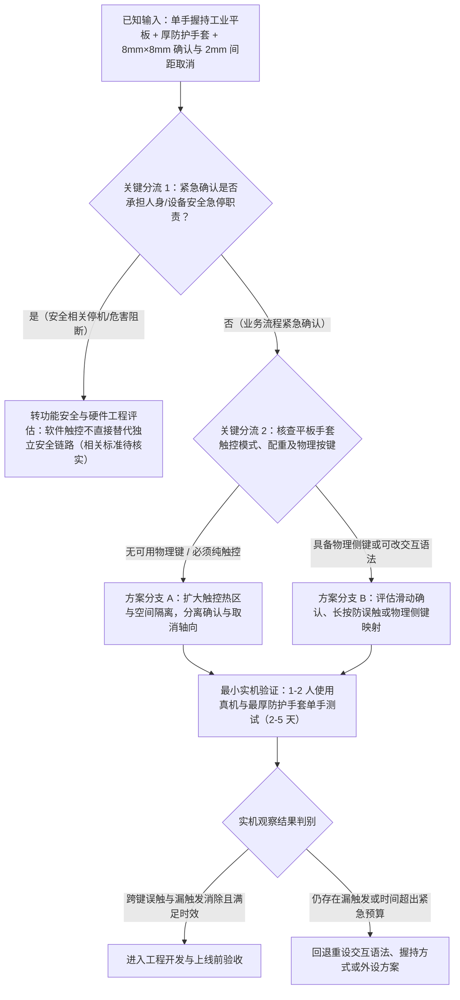

# pilot_c_beta4.md

## Turn 1

**当前判断与核心建议**：基于人因工效学原理与操作几何约束，**当前不建议将“8mm×8mm 紧急确认按钮 + 2mm 边缘间距取消按钮”的并排触控布局，直接用于单手握持工业平板且佩戴厚防护手套的紧急操作场景；建议暂缓该方案定型，先界定“紧急确认”是否承担安全停机职责，再开展热区重构或硬件隔离方案的真手套实机验证。**

该布局在物理层面将“紧急确认”与反向操作“取消”的中心距压缩至 10mm，任意方向越过按钮边缘仅 1mm 即侵入相邻热区。叠加厚手套造成的接触面积扩散、触觉反馈衰减以及单手握持平板的拇指生物力学不稳定性，操作员在紧急时间压力下同时面临**误确认、误取消与漏触发**三重体验与作业风险。此外，若该功能涉及人身或设备安全停机，普通软件触屏界面不能直接替代合规的专用急停链路。

**最小下一步**：1 天内由产品与安全/硬件负责人确认两点核心前提——（1）“紧急确认”是否属安全相关停机功能；（2）平板是否支持手套高灵敏度模式、整机配重及是否有可用物理侧键。若确认为业务级软件确认（非机械急停），建议由 1–2 名研究或体验人员在 2–5 天内使用真实设备与最厚合规防护手套进行单手真机走查，对比“扩大热区并空间隔离”与“滑动确认/物理键映射”的跨键串扰情况。

---

以下为**可直接转换为离线 H5 的中文 Markdown 报告**（结构已对齐离线单文件 H5 报告模块，无外链依赖、无编造量化数据，含 Mermaid 流程图与文本回退）：

```markdown
# 工业手持平板单手厚手套“紧急确认”交互人因评估与决策边界报告

- **评估对象**：工业手持平板交互界面（单手握持、佩戴厚防护手套）
- **核心设计事实**：紧急确认按钮 8mm × 8mm；与取消按钮边缘间距 2mm
- **评估性质**：基于已有设计参数的人因工效预评估与决策边界界定（非实测可用性验收，亦非安全合规认证）
- **外部核验状态**：本轮**未进行外部联网核验**，亦未读取企业内部规范或实测日志；文中涉及的外部标准条目均标注为**待核实**，不可直接作为合规放行或强制禁用裁决依据

---

## 1. 核心判断与条件摘要

- **阶段性决策建议**：暂缓现行“8mm×8mm 紧急确认 + 2mm 边缘间距取消”并排触控方案的定型与上线；先通过安全属性定性与硬件基线核查完成决策分流，再推进对应方案的真机实测。
- **核心体验机制**：在单手负重握持与厚手套佩戴条件下，有限的手指接触斑扩散、握持稳定性与拇指精细控制之间的冲突、以及仅 1mm 的边缘越界容差，会导致高代价的反向操作误触（误点确认或误点取消）与重复点击风险。
- **决策成立前提与边界**：若“紧急确认”属于机械/电气安全停机（急停）功能，则不能仅靠软件触控热区调整解决，须转交功能安全与硬件团队设计独立物理安全链路；若仅属于非安全连锁的业务紧急确认，则可通过扩大热区、拉开异轴空间距离或引入防误触确认语法来优化，但具体尺寸与时间开销须以真实手套实机测试校准。

---

## 2. 决策与评估推进流程（Mermaid 流程图及文本回退）



### 流程文本回退（纯文本结构化视图）

1. **起点（已知输入）**：单手握持工业手持平板、佩戴厚防护手套时，使用 8mm × 8mm 紧急确认按钮，且其与取消按钮边缘间距为 2mm。
2. **关键分流 1（安全属性界定）**：确认“紧急确认”是否承担涉及人身或设备安全的急停/危害阻断职责。
   - **分支 1a（是，属安全相关停机）**：暂止纯软件触控方案推进，转交功能安全与硬件工程团队按适用法规与标准（待核实）评估独立硬件安全链路。
   - **分支 1b（否，属业务流程确认）**：进入硬件基线核查（分流 2）。
3. **关键分流 2（设备与手套基线核查）**：核查平板触控屏在最厚合规手套下的传感灵敏度、整机单手配重及是否具备可编程物理侧键。
   - **分支 2a（纯触控约束）**：优先重构热区尺寸与空间布局，将“确认”与“取消”做远距或异轴隔离。
   - **分支 2b（支持物理键或高置信触控）**：并联对比“大热区空间隔离”、“滑动/长按防误触”或“物理按键映射”。
4. **最小实机验证（2–5 天）**：使用目标平板与最厚防护手套执行单手模拟紧急任务，观察漏触发、跨键误触及紧急操作耗时。
   - **若误触可控且满足时效**：可作为推荐候选进入工程实现与验收。
   - **若仍频繁漏触发或操作超时**：回退调整交互语法、双持作业规范或外设物理方案。

---

## 3. 人因工效评估与体验机制

### 3.1 几何尺度与事实/推断边界拆解

| 维度 | 内容 | 依据类型 | 说明与限制 |
| --- | --- | --- | --- |
| 目标按钮尺寸 | 8mm × 8mm（单按钮面积 64mm²） | 设计事实 | 由当前输入参数直接确定 |
| 相邻边缘间距 | 确认按钮与取消按钮边缘相距 2mm | 设计事实 | 由当前输入参数直接确定 |
| 相邻中心距与越界容差 | 两按钮中心距 = 4mm + 2mm + 4mm = 10mm；从确认按钮中心偏移超过 6mm，或从边缘越界超过 1mm 并跨越 2mm 间隙后即落入取消热区 | 可追溯几何计算 | 纯平面几何推导，假设视觉框与触控热区 1:1 重合 |
| 真实触控热区范围 | 未知（软件实际 Hitbox 是否大于视觉框、是否存在防误触死区） | 待验证 | 若软件热区有扩展而未压缩相邻冲突区，实际间隙可能小于 2mm |
| 手套后实际接触斑尺度 | 未知（取决于手套材质、厚度与手指按压角度） | 待验证 | 厚防护手套通常会显著放大有效接触或遮挡面积 |

### 3.2 竞争性体验机制与反例审查

1. **机制假说一：厚手套接触扩散与邻近反向热区串扰**
   - **机制说明**：厚防护手套增加手指末端直径、钝化表层触觉反馈，并放大手指对屏幕区域的视觉遮挡。当边缘间距仅 2mm 时，指腹倾角偏差或微小横向滑动只需越过 1mm 级间隙即可能触发相反动作（想“紧急确认”却点中“取消”，或想“取消”却误触发“紧急确认”）。
2. **机制假说二：单手握持平板的生物力学负载冲突**
   - **机制说明**：工业手持平板通常具有更高的机身尺寸与重量（具体重量待核实）。单手操作时，同一只手需同时承担“抗重力稳握机身”与“拇指弧线伸展/屈曲精细点击”两项任务。拇指跨越屏幕寻找 8mm 小目标时容易引发重心微移与手腕代偿抖动；且厚手套可能改变手掌与机身边框的摩擦系数，进一步削弱握持稳定性。
3. **机制假说三：手套介质引起的电容衰减与补偿性重按**
   - **机制说明**：若平板触控控制器未针对特定厚度/绝缘材质手套做高灵敏度标定，首个问题可能不是“点偏”，而是“初次点击无响应”或“触摸中心点漂移”。操作员在得不到即时响应反馈时往往会下意识加重按压力度或连续快速补点，从而放大向相邻按钮溢出的概率。
4. **分析模型适用边界（费茨定律 Fitts's Law）**
   - **模型定义与前提**：经典费茨定律香农形式为 $MT = a + b \log_2\left(\frac{D}{W} + 1\right)$，其中 $D$ 为移动距离，$W$ 为沿运动轴向的目标有效宽度，$a, b$ 为特定交互设备与人群的经验回归常数。
   - **本场景局限性**：该模型主要描述无遮挡、无介质衰减条件下的指向运动时间与难度权衡，**不能**直接套用桌面鼠标或裸指常数值来计算戴厚手套单手操作的具体秒数，也不能直接预测电容漏触率或相邻高代价按钮的串扰错误率。本评估仅将其用于方向性机制判断：当手套有效接触宽度与运动离散度增大而目标名义宽度 $W$ 保持 8mm 时，准确命中所需的控制代价上升，在时间紧迫下更容易发生端点越界失误。
5. **不可忽略的反例与制约（Counter-Scenarios）**
   - **过度防误触导致的时效反例**：若为消灭误触而直接引入高摩擦动作（例如复杂二次弹窗、长时间长按或连续多步滑动），在真正分秒必争的紧急事件中可能造成操作延误，反而带来更高业务或作业损失。
   - **真实姿态反例**：若一线操作规程允许在执行“紧急确认”前短暂改用双手扶持，或将平板靠在臂弯/工装面上操作，则单手握持失稳假说会被大幅削弱，但“厚手套遮挡 + 2mm 边缘间距过窄”的触控几何冲突依然存在。

### 3.3 分层体验发现汇总

| 发现编号 | 体验问题与影响 | 已知事实 / 触发机制 | 建议方向 | 证据状态 |
| --- | --- | --- | --- | --- |
| F1 | 相邻反向按钮易产生高代价串扰（误确认或误取消） | 8mm×8mm 按钮与取消按钮仅隔 2mm（中心距 10mm），戴厚手套视触觉受限且有拇指抖动 | 取消并排紧凑排布，扩大热区并在空间上显著分离“确认”与“取消” | 设计事实 + 机制推断 |
| F2 | 单手伸展精准点击稳定性不足 | 同一手掌兼顾工业平板承重与拇指精细定位，紧急状态下易产生速度-精度权衡失衡 | 将高频/紧急操作置于单手舒适拇指区，或评估物理侧键辅助 | 机制推断（待实机确认握持与配重） |
| F3 | 厚手套下可能存在漏触或二次连击溢出 | 厚手套电容衰减或触控漂移未标定，无反馈诱发重按与连击 | 核实手套触控模式并测试真实手套材质；强化按压即时的视觉/振动反馈 | 待验证假设 |

---

## 4. 方案比选与决策边界

| 候选方案 | 最可能改善的目标 | 体验代价与副作用 | 已知实施约束 | 支持依据 | 对结论最不利的反例 | 可逆性与当前状态 |
| --- | --- | --- | --- | --- | --- | --- |
| 1. 保留现状（8mm×8mm、2mm 间距并排触控） | 无研发改动与排期成本 | 同时暴露于误确认、误取消、漏触风险，容错余量极窄 | 若属安全急停场景则存在合规阻断风险 | 几何中心距仅 10mm；厚手套与单手负载均增加指向离散度 | 极少数情况下若使用精细触控笔且双手稳定扶持，可暂时勉强可用 | 可逆，**不建议直接上线 / 建议暂缓** |
| 2. 独立物理按键 / 硬件急停链路（仅当属安全相关急停） | 提供物理盲操手感、强触觉反馈与硬件级安全隔离 | 依赖硬件机身按键或外接安全模块，成本与改造周期较长 | 涉及安全法规与硬件认证周期，需安全工程主导 | 普通软件触屏在无专门功能安全验证下不宜替代安全急停装置（相关标准待核实） | 若该操作实为普通业务工单确认，过度硬件化会造成不必要的成本与携带负担 | 硬件改动可逆性低，**若属安全场景则转专项评估** |
| 3. 软件触控热区与空间隔离重构（仅限非安全急停业务确认） | 显著降低跨键串扰与边缘漏点，保持单手纯触控可行性 | 占用更大单手屏幕空间，可能压缩同屏信息展示 | 需确认目标手套材质下平板触控稳定可用；具体毫米尺寸须实机校准，不采信无出处经验数值 | 增大有效热区并消除邻近反向操作可同时改善命中裕度与防串扰 | 若屏幕尺寸受限且同屏信息密度极高，大按钮可能遮挡关键告警信息 | 软体 UI 改动高可逆，**推荐候选（需实机验证）** |
| 4. 确认语法重构（如长按/滑动确认 + 边缘安全取消区） | 在有限屏幕内大幅降低单次误触引发的不可逆确认 | 增加操作步骤与完成耗时；戴厚手套在颠簸环境下滑动可能中途断触 | 须平衡防误触收益与紧急操作的最大允许耗时 | 将“瞬时点按”改为“有向或持续意图表达”，减少瞬时误碰风险 | 若紧急场景要求亚秒级一触即发，长按或滑动会造成不可接受的响应延迟 | 软体改动高可逆，**待与方案 3 并行对比验证** |

### 决策关键未知与分流触发规则

- **关键未知 A（安全属性）**：本操作是否属于机械/电气安全急停或防人身伤害连锁？
  - 若**是** → 直接排除纯软件按钮方案，转入方案 2（安全工程与硬件链路）。
  - 若**否** → 进入方案 3 与方案 4 的体验取舍与真机验证。
- **关键未知 B（触控硬件与手套匹配度）**：在最厚合规防护手套下，当前平板触控屏的识别率与响应延迟如何？是否具备可自定义的物理侧键？
  - 若**纯触控在目标手套下稳定可靠** → 方案 3（大热区空间隔离）与方案 4（滑动/长按语法）均可候选。
  - 若**厚手套下存在明显电容漏触或断触** → 滑动交互风险显著升高，应优先考虑物理侧键映射或硬件改造。
- **关键未知 C（紧急响应时间上限）**：业务允许从发现告警到完成“紧急确认”的最大耗时是多少？
  - 若**要求极低延迟（即时触发）** → 优先扩大热区并利用空间隔离（方案 3）或物理专键，慎用长按/复杂滑动。
  - 若**允许少量确认时间以换取零误操作** → 可结合空间隔离与防误触语法（方案 4）。

---

## 5. 法规、标准与合规边界核查（待核实清单）

> **权威边界声明**：本报告仅提供人因工程与用户体验决策支持，不构成法律意见或安全合规认证。以下所有外部标准编号与适用边界在本轮均**未进行外部联网核验（待核实）**，仅提示标准族之间的层级差异，最终适用性与条款解读须交由具备资质的安全、法规或合规负责人对照官方现行文本确认。

1. **人因工效学指南与“尺寸阈值”边界**
   - `ISO 9241-920:2024`（已取代废止的 `ISO 9241-920:2009`，涉及触觉与触控交互指南，未核验具体原文，待核实）属于自愿性人因工效指南与概念框架。**此类人因标准不规定固定毫米级的通用按钮尺寸或间距阈值**；本评估不引用任何无出处的经验毫米数字作为标准依据，也不引用无官方目录记录的虚构标准号。
   - `ISO 9241-11:2018`（可用性概念框架，未核验具体原文，待核实）界定了特定使用情境下的有效性、效率与满意度概念，具体工程指标需由产品任务目标与实测定义。
2. **机械急停三层标准与功能安全边界**
   - 若“紧急确认”实质承担设备急停（E-stop）或安全防护职责，行业参考涉及三类不同层级标准（以下标准均未在本轮核验原文条文，标注**待核实**）：
     - `ISO 13850`：机械急停功能的设计原则与通用要求（待核实）；
     - `IEC 60204-1`：机械电气设备安全要求，涵盖 0/1/2 类停机定义（待核实）；
     - `IEC 60947-5-5`：带机械锁扣功能的机电式急停控制开关器件要求（待核实）。
   - **法律效力与适用校准**：ISO 与 IEC 标准在默认状态下属于自愿性国际共识标准，仅在被具体国家/地区法规、指令或采购合同正式纳入引用时才具有约束力，且具体机电执行器结构条款不可脱离设备风险评估任意泛化。此外，普通软件触控界面在未经专门功能安全验证（如 `ISO 13849-1` 或 `IEC 62061` 等，适用性与版本待核实）及完整机械风险评估前，不宜作为安全急停装置使用。

### 跨角色责任分离

| 角色团队 | 负责边界 | 本报告交付内容 |
| --- | --- | --- |
| 用户研究与交互体验 | 任务障碍识别、人因机制分析、候选对比与实机可用性验证方案 | 已提供（条件性人因预评估与试点方案） |
| 功能安全与法规合规 | 判定是否属安全急停、核验适用法域与标准现行有效条款、组织风险评估 | 待确认（决策关键分流前提） |
| 硬件与软件工程 | 核实触控 IC 手套模式、机身握持与物理键资源、实施最终工程改动 | 待提供硬件基线并在方案选定后承接 |
| 业务与产品决策人 | 权衡误操作代价与响应时效、批准验证资源与最终方案放行 | 持有最终拍板与风险接受权 |

---

## 6. 最小下一步验证与逆转条件

### 6.1 最小可行行动（无需大型专项即可启动）

1. **前置核查（第 1 天）**：向安全与硬件团队收集三项核心信息——（1）“紧急确认”的事故危害等级与安全属性；（2）平板型号、单手总重与屏幕在最厚工作手套下的触控技术规格；（3）现行软件热区定义及是否存在物理侧键。
2. **真手套单手试点测试（第 2–5 天，1–2 名人员）**：若确认为非安全急停的业务操作，采用真实工业平板与最厚合规防护手套，对比“现行 8mm/2mm 布局”与“大热区空间隔离布局 / 防误触语法”，在模拟单手站立或轻度晃动姿态下记录：触控无响应次数、跨键误触次数（误点取消或误点确认）、以及从告警出现到成功确认的任务时间。
   - **方法学边界声明**：小样本实机试点仅用于暴露明确的交互阻塞与热区失效模式，不具备总体误触率统计推断或等效性证明效力。

### 6.2 可补充的高价值资料（如有即可进一步收敛判断）

- 设备与手套兼容测试规范或触摸屏规格书（用于消除电容漏触未知）；
- 设备操作安全风险评估或作业指导书（用于确认“紧急确认”的安全边界）；
- 现有现场误触记录、工单回退日志或一线操作员反馈（用于核对真实发生频率与姿态）。

### 6.3 触发推翻/逆转当前判断的条件

- **触发 1**：若安全团队确认该按钮涉及机械急停或人身安全保护 → 推翻所有纯软件触控改良候选，强制转向独立安全硬件方案；
- **触发 2**：若真机实测显示厚手套下触控漏检频繁 → 推翻“仅靠放大触控按钮或滑动即可解决”的判断，转向物理按键或更换触控/手势输入方式；
- **触发 3**：若业务确认该平板实际规定必须使用触控笔或双手托持桌面操作，且最厚手套无需直接触屏 → 单手握持与指腹扩散约束大幅缓解，可重新标定热区下限。

---

## 7. 离线 H5 转换映射说明

本 Markdown 报告各章节可直接映射为离线单文件 HTML 报告（不依赖外部脚本、远程图片或网络字体）：
- **第 1 节** → 报告首屏摘要（`title`、`recommendation`、`confidence`）
- **第 2 节** → 静态流程说明与条件路径卡片
- **第 3 节** → 任务链与人因发现卡片（`journey`、`findings`）
- **第 4 节** → 方案对比卡片（`decision_options`）
- **第 5 节** → 证据与合规边界清单（`evidence`，未核验条目保持纯文本说明，不插入虚构链接）
- **第 6 节** → 下一步行动与逆转条件（`next_step`）
```

---

**可按需深入**：如需进一步展开，我可以继续提供（1）真机戴手套对比试点测试的详细任务脚本与记录表模板；（2）“确认”与“取消”在单手拇指舒适区/伸展区的具体二维布局参考草图说明；或（3）直接对应离线 H5 渲染器输入格式的结构化 JSON 载荷（留空未实测字段，便于本地生成单文件 HTML）。