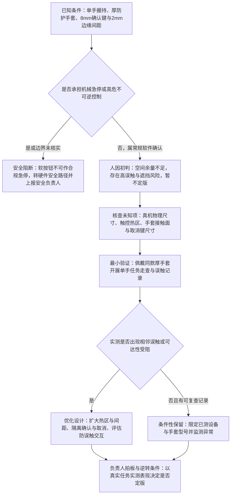

# pilot_c_integrated.md

## Turn 1

# 工业手持平板戴手套单手操作人因评估与决策报告

> 状态说明：本报告基于给定几何尺寸与使用情境完成人因预评估，尚未包含真机物理参数核查、现场实测数据及安全合规审查，不构成安全认证或上线批准。

## 当前判断

在单手握持工业手持平板并佩戴厚防护手套的条件下，**不建议将 `8mm × 8mm` 紧急确认按钮与边缘间距仅 `2mm` 的取消按钮方案直接定版使用**。

这一判断受两条独立边界约束：

1. **安全工程边界**：若“紧急确认”承担机械急停、危险动作终止或安全联锁职责，普通触摸屏软按钮**不得等同于**合规急停装置，必须由安全工程与合规负责人按硬件安全与机器风险评估路径处理，不能仅靠调整屏幕尺寸解决。
2. **交互人因边界**：即便该按钮仅触发可逆或非安全关键的软件流程，`8mm` 边长与 `2mm` 物理间距在厚手套接触面积扩大、手指遮挡以及单手握持精度下降的共同作用下，极易引发相邻误触与确认延误，需先补齐未知参数并做低成本实测或防御性改版。

## 决策边界与评估流程

> **文本回退**：先确认“紧急确认”是否涉及机械急停或高危不可逆控制；若涉及或尚不明确，应立即停止以普通触控按钮承担安全职责，交由安全负责人评估硬件方案。若确认属于常规软件流程，则当前 `8mm × 8mm` 尺寸与 `2mm` 间距属于高风险布局，需先核查真机物理缩放、触控热区、手套形变面积及取消键尺寸，再佩戴同款厚手套做单手任务验证；出现误触或可达性问题时优先调整布局并复测，未发现问题时也仅可在已验证的设备与手套范围内有条件保留，最终由业务与安全相关负责人决策。

## 已知参数、可复现推导与未知项

在缺乏真机硬件与手套规格时，不应推算精确像素尺寸或宣称实验室级精度，需明确区分已知条件、条件推导与关键未知项：

| 类别 | 项目 | 当前状态与说明 | 对决策的影响 |
|---|---|---|---|
| 已知输入 | 紧急确认按钮尺寸 | `8mm × 8mm`（面积 `64 mm²`） | 仅代表标注尺寸，未确认是屏幕直尺实测值还是设计稿估值 |
| 已知输入 | 两按钮边缘间距 | `2mm` | 紧邻排布下，拇指微幅偏移或手套边缘受压即可跨越该间隙 |
| 条件推导 | 中心距估算 | 仅当取消按钮同样宽 `8mm` 且正交对齐时，中心距为 `8÷2 + 2 + 8÷2 = 10mm` | 当前**未知取消按钮实际尺寸与相对方位**，该中心距不可当成已知事实 |
| 关键未知 | 实际像素与缩放倍率 | 未知屏幕英寸对角线、像素分辨率与系统 DPI 缩放 | 换算公式：`像素间距 = 对角线英寸 × 25.4 ÷ √(水平像素² + 垂直像素²)`，缺失时无法核对渲染尺寸 |
| 关键未知 | 有效触控热区 | 未知软件热区是否等于视觉边界、是否设置防误触死区 | 视觉上留白 `2mm`，不代表触控响应区之间存在有效隔离 |
| 关键未知 | 屏幕与手套物理特性 | 未知电容屏手套模式或电阻屏特性、手套厚度、材质与按压形变面积 | 决定单次点击接触斑块大小、信号漂移与多点误判概率 |
| 关键未知 | 握持力学与作业环境 | 未知平板重量、边框遮挡、按钮在单手拇指可达域的位置、震动/油污/水渍 | 决定单手握持稳定性与极端环境下的触控偏移 |
| 关键未知 | 操作后果与可逆性 | 未知点击“紧急确认”与“取消”后的系统动作及是否支持撤销 | 决定误点“确认”或误点“取消”谁的代价更高，以及是否具备容错余地 |

## 人因机制分析与竞争性假设

以下机制属于基于人因工程原理的专业风险推断，用于指导设计排查与实测设计，**不代表已在目标一线人员中观测到具体故障比例**。

| 假设 | 作用机制（为什么重要） | 预期支持证据 | 反证条件（弱化该假设） | 当前状态 |
|---|---|---|---|---|
| 接触斑块扩大与视觉遮挡 | 厚手套加宽指腹接触面并削弱指尖触觉反馈，点击 `8mm` 目标时拇指本身会遮挡按钮及 `2mm` 间隙，极易同时压中取消键或产生落点偏移 | 戴手套单手点击时频繁出现相邻误触、无响应或需反复调整指尖角度重按 | 使用硬质细触点手套、触控屏具备高精度指尖质心算法且实测无相邻串扰 | 待验证 |
| 单手握持可达性与姿态失稳 | 工业平板通常较重且边框厚，单手握持时拇指自然活动弧域有限；按钮偏离舒适区会降低控制精度，甚至迫使作业人员调整握姿引发设备滑落 | 测试中出现手指够不到、必须借用另一只手或手腕大幅悬空才能按准 | 按钮正好落在单手拇指自然舒适区，且机身配有手带/握把稳固支撑 | 待验证 |
| 紧急时间压力下的速度准确率权衡 | 紧急情境下操作员注意力收缩、动作加速，紧邻的“确认”与“取消”放大了动作失误（Slip）的风险；若按钮语义不清晰还会引发认知错误（Mistake） | 计时或模拟突发告警条件下，误按率或犹豫/复核耗时显著上升 | 场景并非实时紧迫操作，或确认/取消之间存在明确的多通道防误触隔离 | 待验证 |
| 替代解释：布局并非唯一瓶颈 | 即使把按钮放大到更大尺寸，若界面未处理误触恢复、视觉状态反馈模糊，或按钮过大反而把取消键挤出单手可达区，问题仍无法解决 | 放大按钮后因单手可达范围变化导致换手率升高，或操作员仍因状态不明不敢点击 | 仅调整目标尺寸与间距后，误触率与任务完成时间即达到预期边界 | 待验证 |

### 最强反例与设计权衡

- **何时现行参数未必立即失败**：如果“紧急确认”仅为低风险软件提示、系统支持清晰且安全的撤销路径、触控热区向远离取消键方向做了非对称扩展，且作业人员实际使用的是表面带导电纤细触点的轻薄防滑手套而非厚重防寒/防割手套，则原有布局的真实误触率可能低于纯几何预期。
- **盲目放大的反面代价**：不能简单认为“按钮越大越好”。在单手握持平板的有限屏幕面积内，盲目放大单个按钮和间距会挤压周围信息展示空间、提高视觉拥挤度，或迫使次要控件退至拇指难达边缘，反而增加握姿调整带来的跌落风险。

## 标准、法规与职责边界

在评估工业设备交互时，必须严格区分概念框架、自愿性标准、机械安全标准及强制性法规：

1. **可用性概念框架与触控指南（非通用毫米阈值）**：**ISO 9241-11:2018** 确立了基于使用情境评估有效性、效率与满意度的框架；**ISO 9241-920:2024** 涉及触觉与触控交互。上述标准及一般人因研究**均不提供**“跨设备、跨手套通用且绝对安全的毫米级最小按钮阈值”。任何具体尺寸数字都不能直接冒充 ISO 或行业强制标准要求。
2. **机械安全与急停规范（软件按钮不可替代）**：若“紧急确认”涉及机械设备危险运动停机或功能安全，相关工程评估通常涉及 **ISO 13850:2015**（机械急停功能原则）、**IEC 60204-1:2016 + AMD1:2021**（机械电气设备安全）及 **IEC 60947-5-5:2026**（电气急停装置）等标准体系。这些标准针对的是经过风险评估与功能安全验证的物理安全回路与急停器件，**普通电容/电阻触摸屏上的软件按钮不可用于替代合规急停**。
3. **当前核查限制**：上述标准名称仅用于明确适用范围与职责边界；具体现行有效版本、原文条款及目标销售/使用国家或地区的强制性法律法规采纳情况，须由具备资质的安全与合规负责人结合设备认证要求核验。

## 方案调整建议与最小验证方案

在正式定版前，建议将后续工作拆分为“安全前置确认”“低成本人因改进”与“最小可控实测”三步推进（以下改进方向属于**设计建议**，不是标准强制条款）：

| 阶段 | 行动内容 | 口径与度量边界 | 负责人 | 限制与降级说明 |
|---|---|---|---|---|
| 第一步：安全与物理口径确认 | 1. 明确“紧急确认”的后果等级与是否涉及危险运动；2. 用直尺实测真机屏幕上的按钮实际显示尺寸、取消键尺寸与系统触控热区范围 | 区分“屏幕物理毫米”与“设计稿名义尺寸”；记录设备型号、屏幕参数、手套厚度与材质 | 安全合规负责人 + 硬件/前端工程师 | 在明确系统后果前，不做交互定版建议 |
| 第二步：防御性布局与交互优化 | 若属软件确认流程，评估以下可逆调整：扩大有效点击热区、拉大确认与取消间距或改为错位/异轴布局、减少紧邻对置；按需评估“滑动确认”或“短按加高容错反馈”，避免单纯依靠缩小或紧邻按钮 | 需同步评估防误触机制（如滑动/长按）在紧急情境下增加的操作耗时，平衡误触率与响应速度 | 交互与工业设计负责人 | 未经真机戴手套验证，不得宣称“已消除误触” |
| 第三步：最小现场模拟实测 | 邀请一线作业人员佩戴**实际配发的最厚防护手套**，以单手日常握持姿态完成模拟突发确认与取消任务 | 明确分母与指标：有效触发次数 ÷ 总尝试次数、误触取消次数 ÷ 总尝试次数、单次识别到触发完成耗时（含失败与重试记录）、握姿调整或脱手近失事件数 | 用户研究或现场工艺负责人 | 若短期无法招募一线员工，可先由团队佩戴同款厚手套在真机上做结构化走查以暴露明显物理阻碍，但内部走查**不能替代**真实用户的发生率或通过率证明 |

## 决策后果、负责人与逆转条件

- **当前决策建议**：暂缓按 `8mm × 8mm` 按钮与 `2mm` 边缘间距定版量产或发布。
- **决策分流规则**：
  - 若业务确认该功能涉及危险动作或安全急停：交由**设备安全与合规负责人**转入物理按键/安全联锁方案。
  - 若确认仅为可逆软件提示：由**产品与交互设计负责人**先执行布局隔离与热区核查，再通过佩戴目标手套的单手实测决定是否放行。
- **逆转条件（何种新证据可推翻当前“暂缓使用”判断）**：同时满足以下可复查证据时，方可重新评估保留现行紧凑尺寸——（1）安全负责人书面确认该按钮不承担安全关键或急停职责且误操作后果完全可逆；（2）在真实配发的工业平板与最厚防护手套条件下，由代表性作业人员完成的单手模拟紧急任务实测显示，相邻键误触率、漏触率与单手握持稳定性均满足业务与安全预设的可接受边界，且热区与屏幕适配参数已锁定版本。