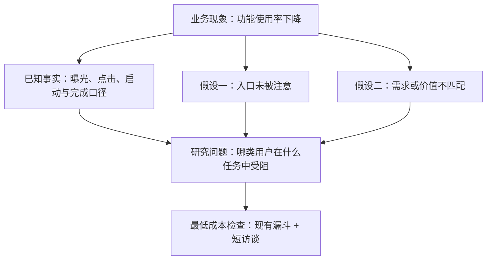

# 新功能入口研究简报

> 状态：研究计划，尚未执行。以下为结构示例，不包含真实用户结果。

## 当前判断

“用户找不到入口”和“需求不强”可以同时存在。先用已有反馈与行为数据定位步骤落差，再决定是否需要短访谈；不直接用低使用率证明低需求。

## 业务问题与研究问题

文本回退：业务现象支持至少两种解释。先核对曝光、点击、启动和完成数据，再用访谈理解用户任务与心智模型。

## 竞争性假设

| 假设 | 预期支持证据 | 反证条件 | 最低成本检查 | 当前状态 |
|---|---|---|---|---|
| 入口未被注意 | 有真实任务的用户反复描述寻找路径 | 用户能迅速找到并启动功能 | 反馈编码 + 曝光后点击 | 待验证 |
| 需求或价值不匹配 | 用户能理解功能但没有近期任务 | 明确任务因入口问题而未使用 | 启动后完成 + 替代方案 | 待验证 |
| 后续流程受阻 | 启动尚可但完成率低 | 进入前已大量流失 | 启动后漏斗 + 工单 | 待验证 |

## 两天降级方案

| 阶段 | 工作 | 产出 | 结论边界 |
|---|---|---|---|
| 第一天上午 | 确认目标用户、任务、版本与数据权限 | 证据清单与指标口径 | 不推测缺失数据 |
| 第一天下午 | 整理反馈；内部同事独立走查 | 反馈编码与设计风险清单 | 内部走查不是用户证据 |
| 第二天上午 | 分析已有漏斗并对照假设 | 假设证据矩阵 | 只报告关联，不宣称因果 |
| 第二天下午 | 形成一页决策简报 | 可逆修补、暂缓事项与补证条件 | 不构成上线批准 |

## 证据与决策关系

| 证据模式 | 可形成的判断 | 决策后果 | 仍不能得出 |
|---|---|---|---|
| 有任务反馈 + 曝光后点击偏低 | 可发现性是较合理的候选问题 | 考虑低风险、可逆入口修正 | 入口是唯一原因或改版必然提升转化 |
| 启动尚可 + 完成偏低 | 主要阻碍可能在功能内部 | 不优先做仅改入口的改版 | 总体需求强弱 |
| 只有内部走查 | 存在潜在设计风险 | 最多触发复查 | 目标用户发现率或痛点排序 |

## 限制与下一步

- 原始反馈和行为数据尚未提供，当前没有可报告的结果。
- 外部招募不可行，两天内不能回答目标用户占比或改版效果。
- 下一步：由项目负责人确认目标用户、典型任务、版本、时间窗和决策人；由数据负责人提供已获授权的材料。
