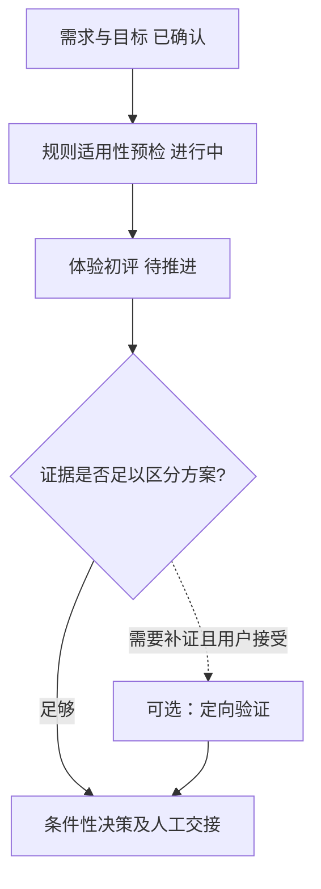

> v0.4D.5 precedence: the common core is not an automatically assigned research route. No optional branches at preset time. Only explicit user confirmations can activate O/E/D/V specialization or research branches. See [Router Scope Contract](router-scope-contract.md).

# Business Progress Map | v0.4D.2 shared O/E/D/V interaction protocol

## What the user sees first

For **every substantive response in any decision project, including the FIRST evaluation turn**, start with one **small, project-specific business-progress flowchart** before detailed analysis, evidence, or recommendations. The map must answer: *current business objective; which stages are confirmed or completed; where we are now; what next 1–3 steps are recommended, optional, or blocked; what the user can prepare/choose*. This is a user-visible **planning and navigation aid**, not the UX journey map, not the Decision Ledger, not a compliance certificate, and not a project management commitment.

- New project: propose a **3–9 step** route, adapting names and length to the problem. Explicitly cover jurisdiction/platform and cognitive-HF/industry-norm applicability when relevant; never label them completed or irrelevant without a verified basis. Do not use a fixed O→E→V→D waterfall. Risk-proportionate jurisdiction/industry-rule preflight belongs before implementation recommendations. Respect dependencies, parallel work and user-confirmed optional branches. Default: `需求/决策界定 → 法规与平台规则适用性 → 人因/行业惯例适用性 → 用户任务与体验评估 → 证据检查 → [待用户确认 O/E/D/V] → 方案选择及业务交接`; remove or combine irrelevant stages.
- Intermediate turn: show a **compact single-line flowchart** plus user-confirmed/identified O/E/D/V scope (or Mermaid when rendering reliably supported) with the current node emphasized, completed/confirmed stages visibly distinct from candidate stages, plus one line for optional/blocked paths and next preparation. Avoid making the user scroll past a giant chart every turn.
- Major stage milestone, plan modification, workflow request or H5 report: render the **expanded flowchart** with dependencies and user-confirmed optional branches. Use a text fallback if Mermaid/diagramming is not available. Do not insist on generating a separate H5 without user acceptance.
- Each stage must identify a *decision-related deliverable*, not just a research activity. After a new source or change, state what was updated and keep unaffected historical steps intact. Show 1–3 next recommended steps rather than confidently inventing the entire downstream execution plan. Mark forecasts and estimated requirements as provisional. No fabricated duration, owners, cost or completion percentage.

## Binding output-template rule

The flowchart is the **first visible response block**, not a footer after a `# D` or `# E` report. All D/E/O/V templates must keep a prefatory business map. Substantive analytical or decision steps within the map must be strictly governed by loading [analytical-quality](analytical-quality.md) and [evidence-boundaries](evidence-boundaries.md). If a short D template calls for a first-screen conclusion, that instruction means the **first analytic content AFTER the map**. See [First-screen Output Gate](first-screen-output-gate.md).

## Status and authority rules

A node has a distinct **progress** and **agreement** status. Use `candidate` (agent suggested), `ready`, `active`, `completed` (with actual evidence reference), `blocked`, `paused`, `skipped`; `confirmed` is separate and only comes from an explicit user choice. Planning a validation is not performing it; a completed research *analysis* is not an authorized launch. Likewise, completing a regional rules *preflight* is not certification.

- **User may explicitly revise/reorder/add/reopen historical nodes**, including confirmed and completed nodes. Keep the old version, reason and affected downstream steps. A user correction is not evidence that a product outcome occurred. Recheck dependent judgments rather than blindly reverting unrelated decisions.
- **Agent may propose** changes or flag a completed item for re-review when new evidence conflicts. It may not silently replace a confirmed route or reopen a completed/skipped step on the user's behalf. If explicit user intent to alter history is absent, show a proposed correction and ask for agreement only when consequential.
- **Approval boundary**: user confirmation of a workflow stage does not authorize regulated implementation, legal exception, financing, launch, data collection or waiver of law. The Jurisdiction & Norms Gate remains independent; external binding rules have their own authorized verification path.
- A blocked/pending-external-input path is a valid stopped state. Do not make up user research findings, stakeholders' approvals or fabricate progress to keep the arrows moving. Do not keep creating nodes after the decision is adequately bounded.

## Local persistence and rendering

For sustained multi-round cases the optional private `business-workflow-vN.json` is the workflow single source of truth; keep it **outside public repository and installed Skills**. `scripts/workflow_map.py` provides:

- `init --input /private/workflow-proposal.json --output /private/workflow-r0.json` (candidate route only, nothing falsely confirmed).
- `render --input /private/workflow-r0.json --format text|mermaid|html [--output /private/workflow.html]`.
- `update --input /private/workflow-r0.json --event /private/user-or-agent-event.json --output /private/workflow-r1.json` (append-only revision with source/actor and expected revision; no in-place overwrite).

The `decision_id` links this plan to the separate Decision/Spiral Ledger. It does **not** automatically edit a decision, perform a study or record a legal review. The client should reconcile **declared deliverables** with reality: only mark `completed` when a referenced outcome actually exists. For rapid chat-only interactions, maintain a readable compact map in conversation without requiring any JSON file or command-line tool. If no persisted plan is available, reconstruct only what the conversation actually supports, clearly label uncertain history as unconfirmed; never invent an earlier agreement.

When a user asks to revise a step, propose the impact on dependent stages and give a route-change preview before committing consequential changes. If the host supports controls, user can select or type an alternative; the same update must also work as a plain-language request. Never force a form or repeat confirmation for steps the user already explicitly approved.

## Format examples (independently fictional case)

Compact turn start:

`业务推进图 r2｜目标：决定是否调整续费提醒 → [已完成]需求界定 → [当前]规则与现有证据核查 → [建议]比较两套文案 → [可选]轻量理解测试 → [候选]试点决策；下一步需：当前文案与适用平台规则。`

Expanded branch view (when requested):

Both are **plans**, not claims that actual research has been done. Use current evidence and permissions to select the truly relevant steps. The example is not a hardcoded route.

## v0.4D.3 compact visual route

The initial H5 view shows last grounded confirmed/completed, current focus and up to two provisional next steps; complete dependencies, optional research and preparation are expandable. In chat, use a compact route before a coherent research judgement. See [Progressive Research Presentation](progressive-research-presentation.md). Never conceal decisive blockers.

## Re-entering O/E after an earlier D report (v0.4D.8)
A D *report delivered* is not a *product decision approved*. In the next O/E map, use `D分析产出：已记录；批准/采纳状态：未确认`, unless a verifiable user/owner decision was actually recorded. Preserve previous D as analysis history while keeping the O/E research open. Do not infer P0/P1/P2, implementation authorization, or regulatory approval from an LLM recommendation. Mandatory read: [O/E Research Scope Integrity](oe-research-scope-integrity.md).

## v0.5A first mode checkpoint

For a NEW project, the compact map begins with `需求 → [当前] 协作模式（教学/决策/评审，待确认） → 目标/法规/用户证据预检 → 范围 O/E/D/V 确认 → 授权范围内分析 → 阶段复盘` rather than presenting a definitive quick-decision plan. Explicit user mode+scope selections may complete both checkpoints immediately. In `guided`, optionally expand S1–S7 learning map; these are learnable milestones, not mandatory new studies. Never silently label D choice or business approval completed.
