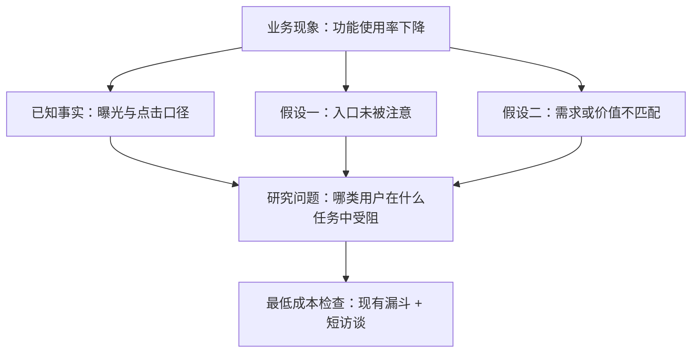
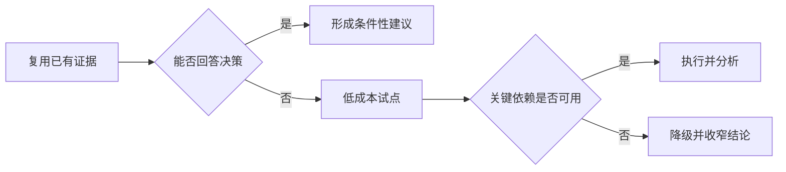
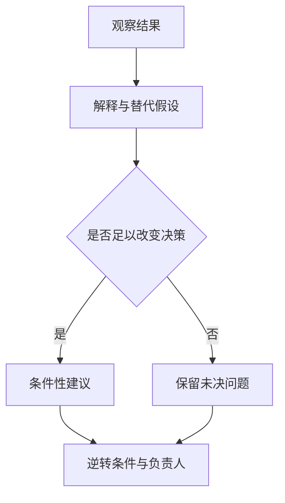

# Markdown visualization and offline H5 reports

Use when a table, diagram, HTML report, or structured export improves understanding. Standard Markdown remains the default; H5 is an optional offline presentation layer.

## 1. Choose the smallest useful form

| Need | Preferred form |
|---|---|
| compare hypotheses or options | Markdown table |
| show task sequence or decision flow | short Mermaid flowchart with text fallback |
| show study stages | milestone table or simple flowchart |
| show variables/conditions | matrix |
| show real descriptive data | table; chart only with defined unit/denominator |
| share a formatted local report | Markdown → self-contained H5 |

Do not build a dashboard for a simple answer. Do not require a web service, CDN, or frontend runtime.

## 2. Markdown document structure

Use a descriptive heading hierarchy. Internal capability names and state codes are not headings.

```markdown
# 研究问题与决策简报

## 当前判断
[条件性建议或仍未解决的决策]

## 关键依据
- 已知事实：
- 观察记录：
- 尚未验证的解释：

## 竞争性假设
| 假设 | 预期支持证据 | 反证条件 | 最低成本检查 | 当前状态 |
|---|---|---|---|---|

## 研究方法与资源
| 阶段 | 方法 | 对象/样本 | 产出 | 依赖与降级 |
|---|---|---|---|---|

## 证据与决策关系
| 证据模式 | 可形成的判断 | 决策后果 | 仍不能得出 |
|---|---|---|---|

## 限制与下一步
[最重要的限制、最小行动、负责人和逆转条件]
```

For English, use the same logic with English headings. Do not mirror every paragraph in two languages unless requested.

## 3. Copy-ready Mermaid structures

### Business problem → research question



Always add a text fallback when the host may not render Mermaid:

> 业务现象同时支持“入口未被注意”和“需求不匹配”两种假设；先用现有漏斗定位步骤落差，再用短访谈理解机制。

### Research phases and fallback



> 文本回退：先复用已有证据；能回答决策则直接形成条件性建议，否则进入低成本试点。关键依赖不可用时降级方法，并同步收窄结论。

### Evidence → decision



> 文本回退：观察结果先与替代解释对照；证据足以改变决策时给出条件性建议，否则保留未决问题。两种路径都要写明逆转条件和负责人。

Do not add scores, percentages, or risk colors unless real data and a defensible method exist. Mermaid color is not evidence.

## 4. Truthful visual rules

Every diagram must distinguish, where relevant:

- known fact or observed result;
- hypothesis;
- proposed method or action;
- unresolved dependency;
- authorized decision.

Do not create radar charts, opportunity scores, confidence percentages, risk scores, or outcome charts without real data and a defensible method. Labels such as “hypothesis / 假设” must remain visible in the visual, not only in surrounding prose.

Avoid internal routing diagrams disguised as research frameworks. Do not expose O/E/D/V, decision ledgers, or audit states unless the user explicitly asks for traceability.

## 5. Markdown → offline H5

Run:

```bash
python scripts/render_markdown_report.py \
  --input /private/path/report.md \
  --output /private/path/report.html \
  --language zh \
  --title "研究问题与决策简报"
```

The output must be outside the installed/public skill tree. The renderer:

- uses only the Python standard library;
- embeds CSS and JavaScript in one HTML file;
- supports headings, paragraphs, flat ordered/unordered lists, blockquotes, tables, inline code, fenced code, and simple safe links;
- renders basic `flowchart TD/LR` Mermaid diagrams as inline SVG;
- falls back to readable Mermaid source for unsupported diagrams;
- escapes raw HTML and script content;
- does not fetch remote images, fonts, scripts, or data;
- includes print and source-view controls.

The renderer is a presentation tool. It does not verify claims, citations, data, or research quality.

### Supported Mermaid subset

- `flowchart TD`, `flowchart LR`, `graph TD`, `graph LR`;
- node labels in `A[文本]`, `A(文本)`, and `A{文本}`;
- arrows `-->`, `-.->`, `==>`, and labeled arrows `-->|文本|`;
- simple chains and acyclic branching.

Unsupported syntax, cycles, or complex diagrams remain visible as source text. Do not depend on the SVG renderer for every Mermaid feature.

## 6. Structured JSON H5 report

For a compact dashboard-like report, use:

```bash
python scripts/render_report.py --input /private/path/report.json --output /private/path/report.html
```

The output must be outside the installed/public skill tree. The renderer performs structural validation and safe text rendering; it does not verify the truth of claims or browse sources. English and Chinese payloads receive localized interface labels, and inspected-source metadata is shown in the evidence section.

### Minimal payload

```json
{
  "title": "Research decision brief",
  "subtitle": "Product, users, task, and version",
  "language": "en",
  "summary": "Current judgment in one paragraph.",
  "recommendation": "Conditional recommendation.",
  "next_step": "Smallest feasible next action.",
  "evidence_boundary": "What the evidence supports and does not support.",
  "sections": [
    {
      "heading": "Research question",
      "body": "The decision-critical unknown."
    }
  ]
}
```

Optional collections:

- `hypotheses`: `hypothesis`, `status`, `support`, `disconfirm`;
- `findings`: `title`, `observation`, `interpretation`, `evidence_status`;
- `options`: `name`, `benefit`, `tradeoff`, `status`;
- `metrics`: `label`, `n`, `value`, `unit`, `denominator_note`;
- `evidence`: `title`, `note`, and optionally an inspected public `url` plus source metadata.

For a public URL, provide `source_status: "CONTENT_INSPECTED"`, `source_title`, `source_publisher`, `source_locator`, `source_retrieval_ref`, and `support_excerpt`. A URL alone is not a verified citation. Do not include private paths.

Synthetic data must be labeled in the title/summary/evidence boundary and any metric note. Do not fabricate findings to populate the template.

## 7. Structured exports

Use JSON for reproducible report data and CSV for metric/event tables. Include a data dictionary, units, missing-value convention, and provenance. Do not include participant-identifying data unless authorized and necessary.

## 8. Review before sharing

- Does the first screen contain the actual judgment?
- Are facts, hypotheses, proposals, and results visually distinct?
- Are all numbers tied to counts, denominators, and scope?
- Are sources inspectable and links real?
- Is the fallback readable without HTML or Mermaid?
- Does the document language match the interface language?
- Is the artifact free of private data and unauthorized distribution?
